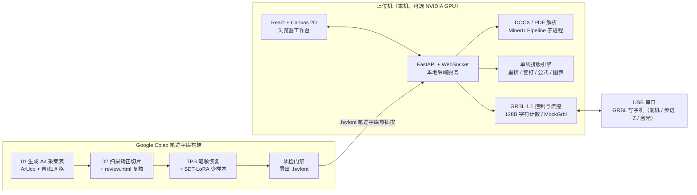

# 墨迹工坊 InkCraft —— 多书写者笔迹排版与 GRBL 写字机上位机

<p align="left">
  <a href="https://github.com/muyangplus/inkcraft"></a>
  <a href="https://github.com/muyangplus/inkcraft/stargazers"></a>
  <a href="https://github.com/muyangplus/inkcraft/issues"></a>
  <a href="LICENSE"></a>
  
  
  
  
  
</p>

> 墨迹工坊是在本机运行的写字机上位机：用手写扫描件构建开放的 `.hwfont` 笔迹字库（本机或 Google Colab），把 DOCX / PDF / 文本（含数学公式、表格、数据图表）排版为手写风格的单线笔画，再通过 GRBL 1.1 写字机流式书写到纸上。术语与写作口径见 [docs/README.md](docs/README.md)。

---

## 核心特性

- **开放的单文件笔迹字库 `.hwfont`（SQLite v1 + `HWS1` 二进制笔画编码）**
  - 每位书写者对应一个可拷贝、只读、可热插拔的笔迹字库文件（`0..1000` 整数坐标系，保留笔顺与起收笔方向）。
  - 支持**同字异形**（每字 3–4 个以上异形，最近 N 次不重复抽样）、**拟人化扰动**（逐字缩放、倾角、基线波动、字符微偏移）与**多字体混写**（多位书写者按权重逐字混排）。
  - 仓库 `fonts/` 预置 3 套演示笔迹字库（林清河行楷、陈墨白行书、苏工图工程体）。
- **文档解析与两种排版模式**
  - 支持导入 `.docx`、`.pdf`、`.txt` / `.md`（自动识别 UTF-8 / GBK），包括正文、LaTeX 数学公式、表格与柱 / 折 / 饼 / 散点数据图表。
  - **重排（Reflow）**：重新排版书写，支持中文禁则、横线 / 方格对齐、孤寡行控制、自动分页。
  - **套打（Overlay）**：叠加原文档半透明底图，按原位置书写；支持整页平移 / 旋转 / 缩放校准与块级 `nudge_mm` 微调，适合打印好的表格或作业纸。
  - **公式与图表单线化**：内置 LaTeX 子集单线盒模型（分式、根号、积分、矩阵、上下标），图表转为手绘单线并以不同剖面线（Hatching）填充。
- **浏览器工作台与写字机安全控制**
  - 分页矢量预览（`Float32Array` 零拷贝路径流）、空移路径显示、**外框试跑（Frame Check）**。
  - 按纸面方向点动（`$J=`）、工作坐标置零（`G92 X0 Y0`）、**暂停 → 换笔 → 原位续写**、多页换纸提示、**带抬笔的急停（E-Stop，< 30 ms）**、断点续写。
  - 内置 **MockGrbl 仿真器**：无需写字机即可完整联调与自动化测试。
- **写字机控制方案（兼容奎享雕刻式 GRBL 写字机）**，详见 [docs/machine_control.md](docs/machine_control.md)
  - 舵机 / 步进 Z / 激光三种笔控；落笔后与抬笔前暂停、开始时自动置零、完成后休眠、单步发送、自定义起止代码与宏。
  - 通用坐标换算（四角原点、机器轴向、XY 互换、偏移、旋转），支持「左上原点、向下书写为 -Y」的写字机。
  - 串口自动识别（优先 CH340），不依赖固定 COM 号；连接时读取固件参数（`$$`）并可在界面修改，`$13=1` 英寸上报自动换算；兼容 GRBL 0.9。
- **笔迹字库构建器（本机 GPU / CPU 与 Google Colab 两种方式）**
  - 只需书写者 1–4 页 A4 手写扫描件，即可完成 ArUco 矫正、青 / 红格线滤除、TPS 笔顺恢复、少样本多异形生成与质检，导出 `.hwfont` 并自动加入书写者列表。

---

## 系统架构



### 目录结构

```text
inkcraft/
├── packages/hwfont_sdk/     # 前后端与 Colab 共享的 .hwfont 编解码与校验 SDK
├── backend/inkcraft/        # FastAPI 后端：api / core / docparse / layout / writers / gcode / grbl / machine
├── frontend/                # React 18 + TypeScript + Vite + Zustand + Canvas 2D 工作台
├── colab_builder/           # 笔迹字库构建器：扫描切字、骨架笔顺恢复、SDT-LoRA 与 Colab Notebook
│   ├── hwbuilder/           # sheet_gen / segment / skeleton_align / model_sdt / qc_export
│   └── notebooks/           # 01_generate_sheets / 02_scan_to_trajectories / 03_train_and_export
├── config/                  # 内置机台档案 (default_profiles.json) 与 MinerU 配置模板
├── fonts/                   # 内置演示笔迹字库
├── scripts/                 # OpenAPI 导出、演示笔迹字库生成、MinerU 显存压测、Windows 打包
├── windows/                 # Windows 一键安装 / 启动脚本
├── docs/                    # 文档索引与术语 (README.md)、功能梳理、写字机连接与控制、设计蓝图
└── tests/                   # 单元测试、确定性回归与 MockGrbl 集成测试
```

> `source/`（第三方软件、授权文件、手写扫描件等本地素材）、`data/`、`dist/`、`.env` 以及个人笔迹字库不纳入版本库。

---

## 本地安装

### 环境要求

- **Python**: `>= 3.11`（推荐使用 [`uv`](https://docs.astral.sh/uv/) 管理 workspace）
- **Node.js**: `>= 20`（用于构建浏览器工作台前端）
- **可选系统工具**：
  - `pandoc >= 3.1`：用于精确解析 DOCX 结构与 OMML 数学公式
  - `LibreOffice (soffice)`：用于 DOCX 原版坐标套打模式转 PDF
  - **NVIDIA GPU（建议显存 ≥ 8 GB）+ CUDA 12.x**：用于本地 MinerU `pipeline` PDF 解析（无 GPU 时自动回退 PyMuPDF 结构化解析器）

### 1. 安装 Python Workspace（`uv`）

```bash
# 在仓库根目录同步全部成员包 (hwfont_sdk, backend, colab_builder)
uv sync

# 或使用传统 venv 可编辑安装
python3 -m venv .venv
source .venv/bin/activate
pip install -e packages/hwfont_sdk -e backend -e colab_builder
```

### 2. 安装并构建前端工作台（`npm`）

```bash
cd frontend
npm install
npm run build
cd ..
```

### 3. （可选）重新生成 3 套内置演示笔迹字库

仓库 `fonts/` 已自带 3 套演示笔迹字库；如需重新生成：

```bash
uv run python scripts/generate_demo_writers.py
```

---

## 一键启动

### 生产 / 本地桌面模式（推荐）

构建好 `frontend/dist` 后，直接执行：

```bash
uv run python -m inkcraft
# 或在激活 .venv 后执行：
python -m inkcraft
```

默认监听 `http://127.0.0.1:8765`（加 `--open-browser` 自动打开浏览器），同时提供前端工作台与后端接口。内置 MockGrbl 仿真机台，未连接写字机也能体验导入、重排 / 套打、外框试跑与流式书写的完整流程。

### 开发联调模式（前后端热重载）

```bash
# 终端 1：启动 FastAPI 后端
uv run uvicorn inkcraft.api.app:create_app --factory --reload --host 127.0.0.1 --port 8765

# 终端 2：启动 Vite 前端（默认代理 /api 与 /ws 到 8765）
cd frontend && npm run dev
```

---

## MinerU `pipeline` GPU 解析部署（可选）

为了让排版、浏览器 Canvas 2D 与 PDF 解析共用一块显卡，墨迹工坊**只使用 MinerU `pipeline` 后端**，不使用 `vlm-vllm-engine` / `vlm-sglang-*` 等按比例预占显存的 VLM 后端。下文以 12 GB 显存为例，其他显存请按比例调整。

### 1. 创建独立 MinerU 虚拟环境（隔离 PyTorch/CUDA 依赖）

```bash
uv venv runtime/mineru-venv --python 3.11
source runtime/mineru-venv/bin/activate
pip install "mineru[pipeline]"

# 预先下载离线模型权重到本地缓存
mineru-models-download
```

### 2. 配置 `config/mineru.env`

复制模板文件并根据本机路径调整：

```bash
cp config/mineru.env.example config/mineru.env
```

关键配置说明（见 [config/mineru.env.example](config/mineru.env.example)）：

```ini
MINERU_BACKEND=pipeline
MINERU_DEVICE_MODE=cuda
MINERU_VIRTUAL_VRAM_SIZE=8          # 限制单批显存上限，目标峰值 <= 8.5GB，保留 >= 3.5GB 余量
MINERU_MODEL_SOURCE=local           # 纯离线运行
MINERU_CHUNK_PAGES=10               # PyMuPDF 每 10 页分块串行送入子进程，单块 OOM 自动拆半重试或降级 CPU
MINERU_MAX_DPI=200
INKCRAFT_MINERU_PYTHON=/path/to/inkcraft/runtime/mineru-venv/bin/python
```

### 3. 显存峰值压测（以 12 GB 显存为例）

使用内置监控脚本（200ms 间隔轮询 `nvidia-smi`）验证多页混排 PDF 的峰值显存 **≤ 8.5 GB**：

```bash
uv run python scripts/bench_mineru_vram.py \
  --pdf /path/to/sample_50p.pdf \
  --chunk-pages 10 \
  --max-vram-gb 8.5 \
  --json-report /tmp/mineru_vram_report.json
```

---

## 写字机接线与安全操作

支持标准 **GRBL 1.1** USB 串口固件（兼容 GRBL 0.9，波特率默认 `115200`）。写字机的全部参数保存在**机台档案**中，内置机台档案见 [config/default_profiles.json](config/default_profiles.json)，参数说明见 [docs/machine_control.md](docs/machine_control.md)。串口默认「自动识别」，连接时自动读取固件参数（`$$`）并校验关键项。

1. **`kx_grbl_stepper_z` / `kx_grbl_laser`（奎享兼容控制方案）**：步进 Z（Z0 抬笔 / Z2 落笔）或激光笔控；左上原点、向下书写为 -Y；落笔后与抬笔前各停 0.2 s；开始时自动置零。步进 Z 笔控下 `$32=1` 不影响书写。
2. **`corexy_servo_a4`（舵机笔控）**
   - **抬笔安全约定**：接线与固件须满足 **`M5`（PWM=0）= 抬笔**、**`M3 S90` = 落笔**，确保上电、报警（Alarm）或软复位（`0x18`）时笔尖自动抬起，不压断笔尖、不拖脏纸面。
   - **关闭激光模式**：连接前确认固件参数 **`$32=0`**，否则 `G0` 空移期间 PWM 会被关闭，影响舵机角度。
   - 建议 `$10=3`，状态报告包含 `MPos` 与 `Bf` 缓冲计数。
3. **`gantry_z_a3`（步进 Z 笔控）**
   - 抬笔 `G0 Z5.0`，落笔 `G1 Z0.0 F1200`；急停（`0x18`）后收到重启欢迎语，100 ms 内朝抬笔方向发送相对退刀指令。
4. **标准书写流程**
   - **连接与点动**：用方向键（按纸面方向）把笔尖移到纸张左上角基准点（`$J=` 点动，`0x85` 即时取消），点击**置零**（`G92 X0 Y0`）。
   - **外框试跑**：正式书写前，全程抬笔沿本页内容外接矩形走一圈，核对纸张位置与工作区边界。
   - **暂停与换笔**：点击「暂停」→ 等待 `Hold:0` 完全静止 → 点击「换笔」移至换笔位 → 更换笔芯并测试抬落笔 → 点击「续写」回到断点原位继续书写。
   - **急停**：随时点击急停按钮或按快捷键，立即发送 `0x18` 软复位并抬笔；排查后须手动**解锁**（`$X`）才能恢复空闲状态。

---

## 构建笔迹字库：本机（GPU / CPU）与 Google Colab

只有书写者纸面扫描件、没有书写过程轨迹时，可用笔迹字库构建器从扫描件恢复笔顺并生成 `.hwfont`。构建可在本机完成，也可在 Google Colab 完成；在浏览器工作台「书写者 → **`+ 构建新笔迹`**」中切换，或使用命令行 `python -m hwbuilder`。

### 方式 A：本机构建（工作台与命令行，扫描件不离开本机）

- **本机 GPU（`local_gpu`）**：已安装 PyTorch CUDA 时，使用 `SDTTrainer`（Style-Disentangled Transformer + LoRA）在本机完成少样本微调与多异形生成。
- **本机 CPU（`local_cpu`）**：无需 PyTorch / GPU，用 NumPy + Pillow 完成四角 ArUco 透视校正、去格线切字、TPS 笔顺恢复，并以 `LocalStyleTransferAugmentor` 合成参数化风格异形，适合快速建模和对隐私要求高的场景。

**工作台操作**：
1. 点击 **`+ 构建新笔迹`**，选择**本机构建**（自动检测本机 CUDA GPU / CPU）；
2. **第 1 步**：选择采集模板（`quick` 1 页 / `standard` 多页 / `custom` 自定义字表），生成并下载 A4 PDF 采集表；
3. **第 2 步**：上传手写扫描件（或勾选「合成样例扫描件」试跑全流程），填写书写者名称、引擎与每字异形数后开始构建；
4. **第 3 步**：查看 `segment → align → synthesize → qc → export` 进度，完成后笔迹字库自动加入书写者列表并设为当前书写者。

**命令行（`python -m hwbuilder`）**：

```bash
# 1) 检测本机 GPU / PyTorch / OpenCV 能力
uv run python -m hwbuilder capabilities

# 2) 生成可打印 A4 ArUco 采集表与 manifest.json
uv run python -m hwbuilder sheets --preset quick --writer zhangsan --grid-color cyan --out ./work/sheets

# 3) 从扫描件（或 --demo-synthetic 样例）在本机构建并校验 .hwfont
uv run python -m hwbuilder build \
  --writer-name "张三" \
  --writer-alias "行楷·本机自建" \
  --scans ./work/scans/page_000.png \
  --manifest ./work/sheets/manifest.json \
  --engine auto \
  --variants 4 \
  --out ./fonts/zhangsan_v1.0.hwfont
```

### 方式 B：Google Colab 构建（适合 GB2312 全部字符的大批量微调）

本机没有 PyTorch CUDA，或想用 Colab 的 T4 / L4 / A100 GPU 对 GB2312 全部字符做微调时：

- **打包任务**：在 **`+ 构建新笔迹`** 中切换到 **Google Colab 构建**，上传扫描件后点击「打包下载 Colab 任务包（.zip）」（接口 `POST /api/v1/font-builder/colab-bundle`），得到包含 3 份 Notebook、`hwbuilder` 与 `hwfont_sdk` 源码、配置文件、`manifest.json` 和扫描件的 `inkcraft_colab_bundle.zip`。扫描件会随任务包上传到你自己的 Google Drive。
- **运行 Notebook**：解压到 Google Drive 后在 Colab 依次运行：
  1. **[`01_generate_sheets.ipynb`](colab_builder/notebooks/01_generate_sheets.ipynb)** — 生成带 4 角 `DICT_4X4_50` ArUco 定位码与淡青/淡红色可滤除格线的 A4 PDF 与 `manifest.json`（彩色 100% 打印，0.5–0.7 mm 黑色中性笔书写，300–600 DPI 彩色扫描）。
  2. **[`02_scan_to_trajectories.ipynb`](colab_builder/notebooks/02_scan_to_trajectories.ipynb)** — 透视矫正、光照归一化、去网格切片、导出交互式 **`review.html`** 人工复核（可导出 `kept_ids.json`），再执行 Zhang-Suen 细化 + 标准笔顺先验（MakeMeAHanzi / Hershey）**TPS 非刚性配准**。
  3. **[`03_train_and_export.ipynb`](colab_builder/notebooks/03_train_and_export.ipynb)** — GPU SDT-LoRA 少样本微调，自动质检（`0..1000` 边界、RDP 点密度、Chamfer 异形差异 `≥ 18u`、可选 OCR 回检），用 `HwFontWriter` 导出并通过 `HwFontReader.verify()` 校验。
- 下载生成的 `.hwfont`，在工作台「书写者」中导入，或复制到 `fonts/`，即可直接使用。

---

## 测试与常用维护命令

```bash
# 运行全部后端与 SDK 单元/集成测试
uv run pytest

# 导出 FastAPI OpenAPI 3.1 Schema 到 docs/openapi.json（供前端类型同步）
uv run python scripts/export_openapi.py

# 校验 OpenAPI 是否与代码保持同步（CI 检查）
uv run python scripts/export_openapi.py --check

# 前端 TypeScript 类型检查与生产构建
cd frontend && npm run typecheck && npm run build
```

---

## 相关文档

- 文档索引、术语表与写作口径：[docs/README.md](docs/README.md)
- 功能梳理：[docs/FEATURES.md](docs/FEATURES.md)
- 写字机连接与控制（含奎享雕刻兼容）：[docs/machine_control.md](docs/machine_control.md)
- Windows 安装：[windows/README_WINDOWS.md](windows/README_WINDOWS.md)
- 设计蓝图（历史文档）：[架构](docs/framework_architecture.md)、[UI 设计规范](docs/ui_design.md)、[视觉原型](docs/ui_prototype.html)

---

## 参与贡献（Contributing）

欢迎提交 Issue 与 Pull Request。开发环境搭建、提交前检查（`pytest`、OpenAPI 同步、前端类型检查）、
代码约定与提交规范见 [CONTRIBUTING.md](CONTRIBUTING.md)。

1. Fork 本仓库并新建分支：`git checkout -b feat/your-feature`
2. 提交改动并确保测试通过：`uv run pytest`
3. 推送分支并发起 Pull Request，描述改动内容与测试方式

## 安全（Security）

发现安全漏洞请**不要**公开提交 Issue，请通过
[GitHub 私密漏洞报告](https://github.com/muyangplus/inkcraft/security/advisories/new) 联系维护者，
详见 [SECURITY.md](SECURITY.md)。服务默认只监听 `127.0.0.1`，请勿暴露到公网。

## 许可证（License）

本项目基于 [Apache License 2.0](LICENSE) 开源，版权声明见 [NOTICE](NOTICE)。

“奎享雕刻”为其权利人的商标；本项目独立实现兼容的 GRBL 控制方案，不包含、不分发、也不依赖其软件、组件或字体。

## 作者

**muyangplus** · [GitHub @muyangplus](https://github.com/muyangplus)

Copyright © 2026 muyangplus
