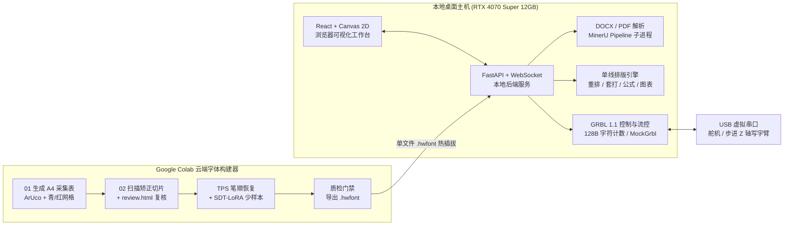

# 墨迹工坊 InkCraft —— AI 多人笔迹与 GRBL 写字机上位机系统

<p align="left">
  <a href="https://github.com/muyangplus/inkcraft"></a>
  <a href="https://github.com/muyangplus/inkcraft/stargazers"></a>
  <a href="https://github.com/muyangplus/inkcraft/issues"></a>
  <a href="LICENSE"></a>
  
  
  
  
  
</p>

> **完全自主可控的本地桌面级写字机械臂排版与控制系统** —— 摆脱闭源商业软件与 `.gfont` 限制，打通「Google Colab 离线纸面扫描建模 → 开放 `.hwfont` 单文件笔迹热插拔 → DOCX/PDF（含数学公式、表格、数据图表）单线矢量排版 → GRBL 1.1 安全流式写字」全链路闭环。

---

## 核心特性

- **开放单文件笔迹格式 `.hwfont`（SQLite v1 + `HWS1` 二进制笔画编码）**
  - 每位书写者打包为单个可拷贝、只读热插拔的 `.hwfont` 文件（`0..1000` 整数坐标系、保留真实笔顺与起收笔方向）。
  - 支持**同字异形**（每字 3–4+ 变体，最近 N 次不重复抽样）与**拟人化扰动**（逐字缩放、倾角、基线波动、字符微偏移）。
  - 仓库 `fonts/` 已预置 3 套可即插即用的多异形演示笔迹（林清河行楷、陈墨白行书、苏工图工程体）。
- **多模态文档解析与双模式排版**
  - 支持上传 `.docx` 与 `.pdf`（正文、LaTeX 数学公式、表格、柱/折/饼/散点数据图表）。
  - **智能手写重排（Reflow）**：支持中文禁则、横线/方格对齐、孤寡行控制、自动分页。
  - **原版坐标套打（Overlay）**：叠加原文档半透明底图，支持整页平移/旋转/缩放校准与块级 `nudge_mm` 微调，贴合打印表格或作业纸。
  - **公式与图表全单线化**：内置 LaTeX 子集单线盒模型（分式、根号、积分、矩阵、上下标）与图表手绘单线 + 差异化剖面线填充（Hatching）。
- **浏览器可视化工作台与 GRBL 安全控制**
  - 高性能分页矢量预览（`Float32Array` 零拷贝路径流）、空移路径显示、**Frame Check 外框边界试跑**。
  - 键盘点动（`$J=`）、工作坐标置零（`G92 X0 Y0`）、**实时暂停 → 换笔 → 原位续写**、多页换纸暂停提示、**< 30 ms 带抬笔急停（E-Stop）**、断点续写。
  - 内置 **`MockGrbl` 物理仿真器**：无硬件串口即可完整联调与自动化测试。
- **原生兼容奎享雕刻式 GRBL 写字机**（详见 [docs/machine_control.md](docs/machine_control.md)）
  - 步进 Z / 舵机 / 激光三种笔控，落笔后与抬笔前暂停、开始时自动置零、完成后休眠、单步发送、自定义起止代码与宏。
  - 通用坐标系（四角原点 / 机器轴向 / XY 互换 / 偏移 / 旋转），支持「左上原点、向下为 -Y」的机器；点动按纸面方向。
  - 串口自动识别（优先 CH340），不依赖固定 COM 号；连接时读取 `$$`，可在界面修改固件参数，`$13=1` 英寸上报自动换算；兼容 GRBL 0.9。
  - 多字体按概率混写，TXT 自动识别 GBK 编码。
- **双模式 AI 字体构建器（本机离线 GPU/CPU + Google Colab 云端）**
  - 系统内置 **本机离线构建** 与 **Google Colab 云端构建** 自由切换，仅需书写者 1–4 页静态 A4 纸面手写扫描件即可完成 ArUco 矫正、青/红网格滤除、TPS 笔顺恢复、少样本多异形生成与质检门禁，导出标准 `.hwfont` 并自动热插拔启用。

---

## 系统架构



### 目录结构

```text
inkcraft/
├── packages/hwfont_sdk/     # 前后端与 Colab 共享的 .hwfont 编解码与校验 SDK
├── backend/inkcraft/        # FastAPI 后端：api / core / docparse / layout / writers / gcode / grbl / machine
├── frontend/                # React 18 + TypeScript + Vite + Zustand + Canvas 2D 工作台
├── colab_builder/           # Google Colab 离线扫描切片、骨架笔顺恢复、SDT-LoRA 与 Notebooks
│   ├── hwbuilder/           # sheet_gen / segment / skeleton_align / model_sdt / qc_export
│   └── notebooks/           # 01_generate_sheets / 02_scan_to_trajectories / 03_train_and_export
├── config/                  # 内置机台档案 (default_profiles.json)、稿纸预设 (presets/) 与 MinerU 配置模板
├── fonts/                   # 预置演示 .hwfont 笔迹库
├── scripts/                 # OpenAPI 导出、演示字库生成、RTX 4070 Super MinerU 显存压测
├── windows/                 # Windows 一键安装 / 启动脚本
├── docs/                    # 功能梳理 (FEATURES.md)、写字机控制方案 (machine_control.md)、架构与 UI 规范
└── tests/                   # 单元测试、确定性回归与 MockGrbl 集成测试
```

> `source/`（第三方软件、授权文件、手稿扫描件等本地素材）、`data/`、`dist/`、`.env` 不纳入版本库。

---

## 本地安装

### 环境要求

- **Python**: `>= 3.11`（推荐使用 [`uv`](https://docs.astral.sh/uv/) 管理 workspace）
- **Node.js**: `>= 20`（用于构建浏览器工作台前端）
- **可选系统工具**：
  - `pandoc >= 3.1`：用于精确解析 DOCX 结构与 OMML 数学公式
  - `LibreOffice (soffice)`：用于 DOCX 原版坐标套打模式转 PDF
  - **NVIDIA RTX 4070 Super (12GB) + CUDA 12.x**：用于本地 MinerU `pipeline` PDF 解析（无 GPU 时自动回退 PyMuPDF 结构化解析器）

### 1. 安装 Python Workspace（`uv`）

```bash
# 在仓库根目录同步全部成员包 (hwfont_sdk, backend, colab_builder)
uv sync

# 或使用传统 venv 可编辑安装
python3 -m venv .venv
source .venv/bin/activate
pip install -e packages/hwfont_sdk -e backend -e colab_builder
```

### 2. 安装并构建前端工作台（`npm`）

```bash
cd frontend
npm install
npm run build
cd ..
```

### 3. （可选）重新生成 3 套内置演示 `.hwfont` 笔迹

仓库 `fonts/` 已自带 3 套演示字体；如需重新生成：

```bash
uv run python scripts/generate_demo_writers.py
```

---

## 一键启动

### 生产 / 本地桌面模式（推荐）

构建好 `frontend/dist` 后，直接执行：

```bash
uv run python -m inkcraft
# 或在激活 .venv 后执行：
python -m inkcraft
```

默认监听 `http://127.0.0.1:8765`，启动后将自动提供前后端服务（含内置 `MockGrbl` 仿真串口，无需连接真实机械臂即可体验完整上传、重排/套打、外框试跑与流式写字）。

### 开发联调模式（前后端热重载）

```bash
# 终端 1：启动 FastAPI 后端
uv run uvicorn inkcraft.api.app:create_app --factory --reload --host 127.0.0.1 --port 8765

# 终端 2：启动 Vite 前端（默认代理 /api 与 /ws 到 8765）
cd frontend && npm run dev
```

---

## RTX 4070 Super (12GB) MinerU `pipeline` 部署指南

为确保本地桌面合成、浏览器 Canvas 2D 与 PDF 解析稳定共存，本系统**强制使用 MinerU `pipeline` 后端**，**严禁启用 `vlm-vllm-engine` / `vlm-sglang-*` 等按比例预占显存的 VLM 后端**。

### 1. 创建独立 MinerU 虚拟环境（隔离 PyTorch/CUDA 依赖）

```bash
uv venv runtime/mineru-venv --python 3.11
source runtime/mineru-venv/bin/activate
pip install "mineru[pipeline]"

# 预先下载离线模型权重到本地缓存
mineru-models-download
```

### 2. 配置 `config/mineru.env`

复制模板文件并根据本机路径调整：

```bash
cp config/mineru.env.example config/mineru.env
```

关键配置说明（见 [config/mineru.env.example](config/mineru.env.example)）：

```ini
MINERU_BACKEND=pipeline
MINERU_DEVICE_MODE=cuda
MINERU_VIRTUAL_VRAM_SIZE=8          # 限制单批显存上限，目标峰值 <= 8.5GB，保留 >= 3.5GB 余量
MINERU_MODEL_SOURCE=local           # 纯离线运行
MINERU_CHUNK_PAGES=10               # PyMuPDF 每 10 页分块串行送入子进程，单块 OOM 自动拆半重试或降级 CPU
MINERU_MAX_DPI=200
INKCRAFT_MINERU_PYTHON=/path/to/inkcraft/runtime/mineru-venv/bin/python
```

### 3. 12GB 显存峰值压测验收

使用内置监控脚本（200ms 间隔轮询 `nvidia-smi`）验证多页混排 PDF 的峰值显存 **≤ 8.5 GB**：

```bash
uv run python scripts/bench_mineru_vram.py \
  --pdf /path/to/sample_50p.pdf \
  --chunk-pages 10 \
  --max-vram-gb 8.5 \
  --json-report /tmp/mineru_vram_report.json
```

---

## GRBL 硬件接线与安全操作规范

支持标准 **GRBL 1.1** USB 虚拟串口固件（波特率默认 `115200`），内置预置配置见 [config/default_profiles.json](config/default_profiles.json)。串口默认「自动识别」，连接时自动读取 `$$` 并校验关键参数。

0. **`kx_grbl_stepper_z` / `kx_grbl_laser`（奎享兼容控制方案）**：步进 Z（Z0 抬笔 / Z2 落笔）或激光笔控，左上原点、向下书写为 -Y，落笔后与抬笔前各停 0.2 s，开始时自动置零，详见 [docs/machine_control.md](docs/machine_control.md)。步进 Z 笔控下 `$32=1` 不影响书写。
1. **`corexy_servo_a4`（舵机抬笔模式）**
   - **硬件 Fail-Safe 强约定**：接线与固件必须满足 **`M5`（主轴停止 / PWM=0）= 抬笔**，**`M3 S90` = 落笔**。确保上电、报警（Alarm）或软复位（`0x18`）瞬间笔尖自动抬起，绝不压断笔尖或拖黑纸面。
   - **禁止激光模式**：连接前务必确认 GRBL 参数 **`$32=0`**（否则 `G0` 空移期间主轴 PWM 行为会干扰舵机角度）。
   - 启用缓冲状态报告：建议确认 `$10=3`（包含 `MPos` 与 `Bf` 缓冲计数）。
2. **`gantry_z_a3`（步进 Z 轴抬笔模式）**
   - 抬笔 `G0 Z5.0`，落笔 `G1 Z0.0 F1200`；在触发急停（`0x18`）收到重启欢迎语后，控制器将在 **100 ms 内**下发安全相对抬笔指令。
3. **写字标准安全流程**
   - **连接与点动**：通过键盘方向键微调笔尖至纸张左上角基准点（`$J=` 支持 `0x85` 即时取消），点击 **置零（`G92 X0 Y0`）**。
   - **外框试跑（Frame Check）**：正式落笔前务必执行外框边界试跑——全程强制抬笔沿本页内容外接矩形四角走一圈，核对纸张位置与工作区边界。
   - **实时暂停与换笔**：点击「暂停」→ 等待 `Hold:0` 完全静止 → 点击「换笔」自动移至 `pen_change_pos_mm` → 更换笔芯并测试抬落笔 → 点击「续写」精确回到断点原位继续书写（无丢步）。
   - **急停（E-Stop）**：随时点击急停按钮或按快捷键直接发送高优先级 `0x18` 软复位并强制抬笔；排查机械与笔尖后必须人工确认 **解锁（`$X`）** 方可恢复 `IDLE`。

---

## AI 笔迹字体构建：本机离线（GPU/CPU）与 Google Colab 云端双模式

针对「仅有书写者纸面静态扫描件、无在线笔顺轨迹」的场景，系统同时支持 **本机离线构建（RTX 4070 Super GPU / 纯 CPU）** 与 **Google Colab 云端构建**，可在浏览器工作台左侧「书写者管理 → **`+ 构建新笔迹`**」弹窗中一键切换，也可通过命令行 `python -m hwbuilder` 执行。

### 模式 A：本机离线构建（Web 工作台 & CLI，无需上传云端）

- **本机 GPU 模式（`local_gpu`）**：当本机安装了 PyTorch CUDA（如 RTX 4070 Super 12GB）时，自动启用 `SDTTrainer`（Style-Disentangled Transformer + LoRA）在本地完成少样本微调与多异形生成。
- **本机 CPU 模式（`local_cpu`）**：无需 PyTorch/GPU，纯离线（NumPy + Pillow）完成四角 ArUco 透视校正、去网格切片、TPS 笔顺恢复与 `LocalStyleTransferAugmentor` 参数化风格多异形合成，适合快速建模与隐私敏感场景。

**Web 工作台操作**：
1. 点击左侧面板 **`+ 构建新笔迹`**，顶部选择 **本机离线构建**（自动探测本机 CUDA GPU / CPU 能力）；
2. **第 1 步**：选择采集模板（`quick` 快速 1 页 / `standard` 标准多页 / `custom` 自定义字表）生成并下载 A4 PDF 采集表；
3. **第 2 步**：上传手写扫描图（或勾选 **「合成样例扫描件快速体验」** 零素材测试全流程），填写书写者名称、引擎与每字异形数后启动后台构建；
4. **第 3 步**：实时查看 `segment → align → synthesize → qc → export` 进度条，完成后自动导入并热插拔切换为当前书写者！

**本机命令行 CLI（`python -m hwbuilder`）**：

```bash
# 1) 检测本机 GPU / PyTorch / OpenCV 能力
uv run python -m hwbuilder capabilities

# 2) 生成可打印 A4 ArUco 采集表与 manifest.json
uv run python -m hwbuilder sheets --preset quick --writer zhangsan --grid-color cyan --out ./work/sheets

# 3) 从真实扫描件（或 --demo-synthetic 样例）本机离线构建并校验 .hwfont
uv run python -m hwbuilder build \
  --writer-name "张三" \
  --writer-alias "行楷·本机自建" \
  --scans ./work/scans/page_000.png \
  --manifest ./work/sheets/manifest.json \
  --engine auto \
  --variants 4 \
  --out ./fonts/zhangsan_v1.0.hwfont
```

### 模式 B：Google Colab 云端 GPU 构建（适合全字库大批量微调）

若本机无 PyTorch CUDA 或希望借助 Colab 免费 T4 / L4 / A100 GPU 跑完整 GB2312 全字库微调：

- **方式 1（Web 一键打包）**：在 **`+ 构建新笔迹`** 弹窗切换到 **Google Colab 云端构建**，上传扫描件后点击 **「打包下载 Colab 云端任务包 (.zip)」**（调用 `POST /api/v1/font-builder/colab-bundle`），自动将 3 份 Notebook、`hwbuilder` + `hwfont_sdk` 源码、配置文件、`manifest.json` 与扫描件打包为 `inkcraft_colab_bundle.zip`。
- **方式 2（直接运行 Notebook）**：解压上传至 Google Drive 后在 Colab 依次运行：
  1. **[`01_generate_sheets.ipynb`](colab_builder/notebooks/01_generate_sheets.ipynb)** — 生成带 4 角 `DICT_4X4_50` ArUco 定位码与淡青/淡红色可滤除格线的 A4 PDF 与 `manifest.json`（彩色 100% 打印，0.5–0.7 mm 黑色中性笔书写，300–600 DPI 彩色扫描）。
  2. **[`02_scan_to_trajectories.ipynb`](colab_builder/notebooks/02_scan_to_trajectories.ipynb)** — 透视矫正、光照归一化、去网格切片、导出交互式 **`review.html`** 人工复核（可导出 `kept_ids.json`），再执行 Zhang-Suen 细化 + 标准笔顺先验（MakeMeAHanzi / Hershey）**TPS 非刚性配准**。
  3. **[`03_train_and_export.ipynb`](colab_builder/notebooks/03_train_and_export.ipynb)** — GPU SDT-LoRA 少样本微调 + 自动化质检门禁（`0..1000` 边界、RDP 点密度、Chamfer 异形多样性 `≥ 18u`、可选 OCR 回检）+ `HwFontWriter` 导出并通过 `HwFontReader.verify()` 校验。
- 下载云端产出的 `.hwfont` 文件，回到本地工作台拖入「书写者管理」或拷入 `fonts/` 即刻热插拔生效。

---

## 测试与常用维护命令

```bash
# 运行全部后端与 SDK 单元/集成测试
uv run pytest

# 导出 FastAPI OpenAPI 3.1 Schema 到 docs/openapi.json（供前端类型同步）
uv run python scripts/export_openapi.py

# 校验 OpenAPI 是否与代码保持同步（CI 检查）
uv run python scripts/export_openapi.py --check

# 前端 TypeScript 类型检查与生产构建
cd frontend && npm run typecheck && npm run build
```

---

## 相关文档

- 系统框架与架构蓝图：[docs/framework_architecture.md](docs/framework_architecture.md)
- UI/UX 交互设计规范：[docs/ui_design.md](docs/ui_design.md)
- 静态可交互视觉原型：[docs/ui_prototype.html](docs/ui_prototype.html)
- 功能梳理：[docs/FEATURES.md](docs/FEATURES.md)
- 写字机控制方案（兼容奎享雕刻式 GRBL 写字机）：[docs/machine_control.md](docs/machine_control.md)

---

## 参与贡献（Contributing）

欢迎提交 Issue 与 Pull Request！开发环境搭建、提交前检查（`pytest`、OpenAPI 同步、前端类型检查）、
代码约定与提交规范见 [CONTRIBUTING.md](CONTRIBUTING.md)。

1. Fork 本仓库并新建分支：`git checkout -b feat/your-feature`
2. 提交改动并确保测试通过：`uv run pytest`
3. 推送分支并发起 Pull Request，描述改动内容与测试方式

## 安全（Security）

发现安全漏洞请**不要**公开提交 Issue，请通过
[GitHub 私密漏洞报告](https://github.com/muyangplus/inkcraft/security/advisories/new) 联系维护者，
详见 [SECURITY.md](SECURITY.md)。服务默认只监听 `127.0.0.1`，请勿暴露到公网。

## 许可证（License）

本项目基于 [Apache License 2.0](LICENSE) 开源，版权声明见 [NOTICE](NOTICE)。

“奎享雕刻”为其权利人的商标；本项目独立实现兼容的 GRBL 控制方案，不包含、不分发、也不依赖其软件、组件或字体。

## 作者

**muyangplus** · [GitHub @muyangplus](https://github.com/muyangplus)

Copyright © 2026 muyangplus
