# 独立 AI 多人笔迹与 GRBL 写字机械臂上位机系统 —— 系统框架与架构蓝图

> 文档编号：HW-ARCH-001 · 版本：v1.0 · 负责人：framework-architect
> 姊妹文档：[`ui_design.md`](./ui_design.md)（UI/UX 规范，ui-designer 维护）、[`ui_prototype.html`](./ui_prototype.html)
> 本文档中的 **§12 接口契约（REST / WebSocket / JSON Schema / 状态枚举）** 是前后端唯一事实来源（Single Source of Truth），任何字段改动必须同步修改本节与 `ui_design.md`，并递增 `contract_version`。

---

## 目录

1. [目标、范围与设计原则](#1-目标范围与设计原则)
2. [总体架构](#2-总体架构)
3. [坐标系、单位与数值约定](#3-坐标系单位与数值约定)
4. [`.hwfont` 单文件笔迹字体格式规范](#4-hwfont-单文件笔迹字体格式规范)
5. [笔迹运行时：热插拔、异形选择与回退链](#5-笔迹运行时热插拔异形选择与回退链)
6. [文档解析层：DOCX / PDF → 统一中间表示 DocIR](#6-文档解析层docx--pdf--统一中间表示-docir)
7. [RTX 4070 Super 12GB 显存预算与 MinerU Pipeline 部署](#7-rtx-4070-super-12gb-显存预算与-mineru-pipeline-部署)
8. [排版引擎：智能手写重排 与 原版坐标套打](#8-排版引擎智能手写重排-与-原版坐标套打)
9. [LaTeX 单线盒模型（数学公式排版）](#9-latex-单线盒模型数学公式排版)
10. [表格与图表：手绘单线 + 剖面线填充流水线](#10-表格与图表手绘单线--剖面线填充流水线)
11. [拟人扰动模型](#11-拟人扰动模型)
12. [接口契约：REST + WebSocket + JSON Schema](#12-接口契约rest--websocket--json-schema)
13. [路径优化与 G-code 编译](#13-路径优化与-g-code-编译)
14. [GRBL 通信、流式传输与安全协议](#14-grbl-通信流式传输与安全协议)
15. [任务、持久化与断点续写](#15-任务持久化与断点续写)
16. [Colab 云端 AI 字体构建器架构](#16-colab-云端-ai-字体构建器架构)
17. [前端集成要点](#17-前端集成要点)
18. [目录脚手架](#18-目录脚手架)
19. [测试、质量与非功能指标](#19-测试质量与非功能指标)
20. [风险登记与对策](#20-风险登记与对策)
21. [分阶段实施路线图](#21-分阶段实施路线图)

---

## 1. 目标、范围与设计原则

### 1.1 业务目标

| 编号 | 目标 | 衡量标准 |
|---|---|---|
| G1 | 摆脱闭源写字软件与 `.gfont` 限制 | 全链路（字体构建→排版→G-code→串口）零商业依赖；自研开放格式 `.hwfont` |
| G2 | 解决离线扫描件无笔顺问题 | 由静态扫描恢复有向、有序的单线轨迹，笔顺正确率 ≥ 95%（以标准笔顺库为参照） |
| G3 | 消除"机器感"重复 | 每字 ≥ 3 个异形（同字异形），并叠加逐字缩放/倾斜/基线波动扰动；相邻 N 次同字不重复同一异形 |
| G4 | 普通文档中的数学公式与数据图表可写 | LaTeX 子集公式按单线盒模型排版；图表转为手绘单线 + 剖面线填充 |
| G5 | 安全可控的多页写字 | Frame Check、点动、置零、即时暂停/换笔/续写、带抬笔急停、多页换纸提示、断电续写 |

### 1.2 范围

- **本地端（Host）**：Python 3.11 后端 + 浏览器可视化工作台（React/TypeScript/Canvas 2D），本地离线运行，GPU 仅用于 MinerU PDF 解析。
- **云端（Builder）**：Google Colab 上的批量扫描分割、标注、轨迹恢复与少样本生成，产出 `.hwfont`。
- **不在范围**：闭环视觉对位、多机并发、GRBL 固件修改（仅要求标准 GRBL 1.1 及常见舵机分支）。

### 1.3 设计原则

1. **契约优先**：后端以 Pydantic 模型定义 API；OpenAPI 与 TS 类型自动生成，杜绝前后端字段漂移。
2. **纯函数排版管线**：`DocIR + Writer + LayoutConfig(含 seed) → Layout` 是确定性纯函数；同输入同输出，可回归测试（golden file）。
3. **硬件安全默认值（Fail-Safe）**：任何异常路径的终态必须是"抬笔 + 停止运动"；舵机模式强制 `M5 = 抬笔`，使 GRBL 复位/报警天然抬笔。
4. **重计算隔离**：MinerU 跑在独立子进程（可杀、显存随进程释放）；排版跑在进程池；串口 I/O 跑在专用线程，绝不被排版或解析阻塞。
5. **单文件可移植**：一位书写者 = 一个 `.hwfont` SQLite 文件，可拷贝、可热插拔、可只读打开。
6. **可扩展**：解析器、图表渲染器、G-code 方言、笔控方式均以注册表/Protocol 插件化。

---

## 2. 总体架构

### 2.1 逻辑分层

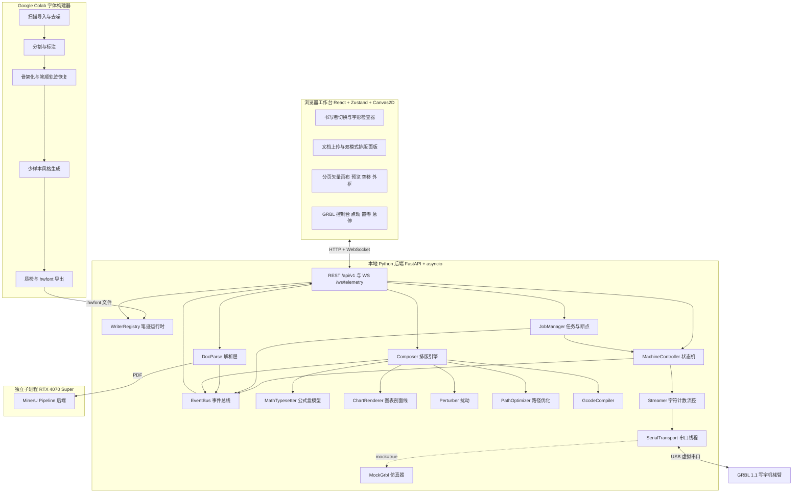

### 2.2 端到端数据流

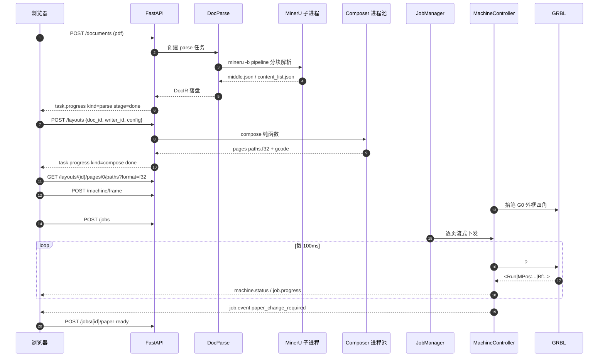

### 2.3 进程与线程模型

| 执行单元 | 内容 | 理由 |
|---|---|---|
| 主进程 asyncio 事件循环（uvicorn 单 worker） | REST、WS 广播、任务编排、状态机 | 状态集中、无跨进程锁 |
| 串口专用线程 `SerialIOThread` | 阻塞读写 pyserial；实时字节优先通道 | 不受 GIL 长任务/事件循环抖动影响，`!`/`0x18` 端到端延迟 < 20 ms |
| 状态轮询定时器（在 IO 线程内） | 以 `status_hz`（默认 10 Hz）写入 `?` | 实时命令不占 RX 缓冲计数 |
| `ProcessPoolExecutor(max_workers=cpu-2)` | 排版、公式、图表、路径优化、G-code 编译 | CPU 密集，规避 GIL |
| MinerU 子进程（独立 venv 可选） | GPU 推理，`concurrency=1` | 显存隔离、OOM 可杀可重试、依赖隔离（torch 版本锁定） |
| LibreOffice headless 子进程 | DOCX→PDF（仅套打模式） | 获取 Word 原版坐标 |

线程/进程之间只通过 **不可变消息** 通信：`queue.SimpleQueue`（IO 线程↔事件循环，经 `loop.call_soon_threadsafe` 投递），`EventBus`（asyncio pub/sub）。

### 2.4 技术栈

| 层 | 选型 | 备注 |
|---|---|---|
| Web 框架 | FastAPI + uvicorn + Pydantic v2 | OpenAPI → `openapi-typescript` 生成前端类型 |
| 串口 | pyserial 3.5（`serial_for_url` 支持 `socket://`、`loop://` 用于仿真） | |
| DOCX | pandoc ≥ 3.1（结构 + OMML→TeX）、python-docx + lxml（页面设置、图表 XML、图片） | |
| PDF | MinerU 2.x `pipeline` 后端；PyMuPDF（矢量图元、页面渲染、文本层快速路径） | 明确禁用 vLLM / sglang / vlm 后端 |
| 几何 | numpy、shapely 2.x（多边形裁剪/剖面线）、scipy（样条、KD-Tree） | |
| 数据 | SQLite（`.hwfont`、`app.db`）、文件系统（大对象） | |
| 前端 | React 18 + TypeScript + Vite + Zustand + Canvas 2D（OffscreenCanvas/Worker） | 细节见 `ui_design.md` |
| 打包 | `uv` 管理环境；`python -m handwrite` 启动并自动打开浏览器；可选 pywebview 壳 | |
| 云端 | Colab（T4/L4/A100）、PyTorch 2.x、OpenCV、scikit-image | |

---

## 3. 坐标系、单位与数值约定

| 空间 | 原点 | 轴向 | 单位 | 精度/类型 |
|---|---|---|---|---|
| 字形空间（`.hwfont`） | em 框左上角 | x→右，y→下 | 字形单位 u，em = 1000 | 整数 `0..1000`（advance 允许至 2000） |
| 页面空间（排版/预览/接口） | 纸张左上角 | x→右，y→下 | 毫米 mm | float，接口序列化保留 2 位小数 |
| 机器空间（G-code） | 工作坐标原点（置零点） | 依 `MachineProfile.origin / invert_x / invert_y` 变换 | mm | G-code 输出 3 位小数，去尾零 |

**字形度量（默认，可在 meta 中覆盖）**：`units_per_em=1000`、`baseline_y=800`、`cap_height=700`（即 y=100 处为大写字母顶）、`x_height=480`（即 y=320）、CJK 字面框建议 `[60,940]`。

**换算**：`mm = u / 1000 × font_size_mm`；`font_size_mm` 指 em 框高度。

**页面 → 机器变换**（`origin=top_left` 时为恒等，仅平移到工作原点）：

```
X_m = (invert_x ? (page_w - x) : x) + frame_offset_x
Y_m = origin == "bottom_left" ? (page_h - y) : y
Y_m = invert_y ? -Y_m : Y_m
```

**页码**：全系统统一 0 基 `page_index`；UI 显示时 +1。

---

## 4. `.hwfont` 单文件笔迹字体格式规范

### 4.1 设计要点

- 单文件 SQLite 3（`PRAGMA application_id = 0x48574654`，即 ASCII `HWFT`；`PRAGMA user_version = 1` 表示格式主版本）。
- 本地以只读 URI 打开：`file:/path/x.hwfont?mode=ro&immutable=1`，支持多进程并发读、拷贝即迁移、热插拔不加锁。
- 坐标为 `0..1000` 整数；笔画以紧凑二进制 BLOB（`HWS1` 编码）存储，并附 bbox 冗余列便于检索与校验。
- 每个字符可有多个异形（variant），带来源、质量分与抽样权重。
- 生产方（Colab Builder）与消费方（Host）共用同一个 `hwfont_sdk` Python 包，保证编解码一致。

### 4.2 SQLite DDL（格式 v1）

```sql
PRAGMA application_id = 1213679188;   -- 0x48574654 'HWFT'
PRAGMA user_version   = 1;            -- 格式主版本
PRAGMA journal_mode   = DELETE;       -- 发行文件不得为 WAL，确保单文件
PRAGMA foreign_keys   = ON;

-- 1) 元数据：键值对，value 一律为 JSON 文本
CREATE TABLE meta (
    key   TEXT PRIMARY KEY,
    value TEXT NOT NULL CHECK (json_valid(value))
) WITHOUT ROWID;

-- 2) 字符表：每个 Unicode 码位一行
CREATE TABLE glyphs (
    glyph_id        INTEGER PRIMARY KEY,
    codepoint       INTEGER NOT NULL UNIQUE CHECK (codepoint BETWEEN 0 AND 1114111),
    char            TEXT    NOT NULL,
    category        TEXT    NOT NULL CHECK (category IN
                        ('cjk','latin','digit','punct','symbol','greek','other')),
    advance         INTEGER NOT NULL DEFAULT 1000 CHECK (advance BETWEEN 0 AND 2000),
    default_variant INTEGER,                         -- variants.variant_id，可空
    note            TEXT
);

-- 3) 异形表：同字异形；strokes 为 HWS1 二进制编码
CREATE TABLE variants (
    variant_id   INTEGER PRIMARY KEY,
    glyph_id     INTEGER NOT NULL REFERENCES glyphs(glyph_id) ON DELETE CASCADE,
    variant_no   INTEGER NOT NULL CHECK (variant_no >= 0),
    source       TEXT    NOT NULL CHECK (source IN
                     ('scan','generated','augmented','manual','builtin')),
    quality      REAL    NOT NULL DEFAULT 1.0 CHECK (quality BETWEEN 0 AND 1),
    weight       REAL    NOT NULL DEFAULT 1.0 CHECK (weight > 0),
    stroke_count INTEGER NOT NULL CHECK (stroke_count BETWEEN 1 AND 64),
    point_count  INTEGER NOT NULL CHECK (point_count >= 2),
    bbox_x0 INTEGER NOT NULL CHECK (bbox_x0 BETWEEN 0 AND 1000),
    bbox_y0 INTEGER NOT NULL CHECK (bbox_y0 BETWEEN 0 AND 1000),
    bbox_x1 INTEGER NOT NULL CHECK (bbox_x1 BETWEEN bbox_x0 AND 1000),
    bbox_y1 INTEGER NOT NULL CHECK (bbox_y1 BETWEEN bbox_y0 AND 1000),
    advance      INTEGER CHECK (advance BETWEEN 0 AND 2000),   -- 覆盖 glyphs.advance
    strokes      BLOB    NOT NULL,
    created_at   TEXT    NOT NULL DEFAULT (strftime('%Y-%m-%dT%H:%M:%SZ','now')),
    UNIQUE (glyph_id, variant_no)
);
CREATE INDEX idx_variants_glyph ON variants(glyph_id);

-- 4) 可选：拉丁字母对字距
CREATE TABLE kerning (
    left_cp  INTEGER NOT NULL,
    right_cp INTEGER NOT NULL,
    adjust   INTEGER NOT NULL CHECK (adjust BETWEEN -500 AND 500),
    PRIMARY KEY (left_cp, right_cp)
) WITHOUT ROWID;

-- 5) 可选：检查器用资源（原始扫描切片、缩略图），不参与写字
CREATE TABLE variant_assets (
    variant_id INTEGER NOT NULL REFERENCES variants(variant_id) ON DELETE CASCADE,
    kind       TEXT    NOT NULL CHECK (kind IN ('scan_png','thumb_png')),
    data       BLOB    NOT NULL,
    PRIMARY KEY (variant_id, kind)
) WITHOUT ROWID;

-- 6) 覆盖率视图
CREATE VIEW v_coverage AS
SELECT category,
       COUNT(*)                                   AS glyph_count,
       SUM((SELECT COUNT(*) FROM variants v WHERE v.glyph_id = g.glyph_id)) AS variant_count
FROM glyphs g GROUP BY category;
```

### 4.3 `meta` 键规范（与 UI 契约一致）

| key | JSON 类型 | 必填 | 说明 / 示例 |
|---|---|---|---|
| `format_version` | string | ✔ | `"1.0"`；主版本须与 `user_version` 一致 |
| `writer_id` | string (UUIDv4) | ✔ | 全局唯一书写者 ID；热插拔与布局引用的主键 |
| `writer_name` | string | ✔ | `"张三"` |
| `writer_alias` | string | | 显示别名 `"三号笔迹·行楷"` |
| `author` | string | | 字体制作人 |
| `version` | string | ✔ | 字体内容版本（SemVer）`"1.2.0"` |
| `style_tags` | string[] | | `["行楷","偏右倾","中等笔速"]` |
| `units_per_em` | int | ✔ | 固定 `1000` |
| `baseline_y` | int | ✔ | 默认 `800` |
| `x_height` / `cap_height` | int | ✔ | 以 em 框为参照的高度（单位 u） |
| `default_advance` | int | ✔ | 默认 `1000`（CJK 全宽） |
| `glyph_count` / `variant_count` | int | ✔ | 冗余统计，导出时写入 |
| `coverage` | object | ✔ | `{"cjk":3755,"latin":52,"digit":10,"punct":48,"symbol":120}`（字符数） |
| `builder` | string | ✔ | `"hwbuilder 0.4.1 (colab)"` |
| `model` | string | | `"sdt-fewshot-lora r8 / ckpt 2026-10-01"` |
| `created_at` | string ISO8601 | ✔ | |
| `license` | string | | 使用授权（书写者本人授权声明） |
| `preview_text` | string | | 检查器预览句 `"永和九年，岁在癸丑 E=mc²"` |
| `preview_char` | string | | 列表缩略图字符 `"永"` |
| `content_sha256` | string | ✔ | 对 glyphs/variants 规范化序列（按 codepoint, variant_no 排序后拼接）求 SHA-256，用于完整性校验 |

### 4.4 笔画 BLOB 编码 `HWS1`

```
offset  size   字段
0       4      magic = 'H','W','S','1'
4       1      flags: bit0=has_pressure(u8/点) bit1=has_time(u16 ms 增量/点) 其余保留=0
5       1      stroke_count  (1..64)
6..     *      stroke[i]:
                 varint  point_count (>=2)
                 u16le   x0, u16le y0                 -- 首点绝对坐标 0..1000
                 (point_count-1) × { zigzag-varint dx, zigzag-varint dy }
                 [flags.bit0] point_count × u8 pressure
                 [flags.bit1] point_count × varint dt_ms
```

- 每笔方向即书写方向（起笔→收笔），**笔画顺序即笔顺**，运行时严禁对字形笔画做反向优化（见 §13.1）。
- 编码约束：点距 ≥ 3u、≤ 60u（导出时重采样），单字点数通常 40–400，压缩后平均 ≈ 0.3–0.8 KB/异形；GB2312 一级 3755 字 × 4 异形 ≈ 6–10 MB。

### 4.5 SDK 接口（`hwfont_sdk`，Host 与 Builder 共用）

```python
@dataclass(frozen=True, slots=True)
class Stroke:            # 单笔，int16 数组 shape=(N,2)，字形单位
    pts: np.ndarray

@dataclass(frozen=True, slots=True)
class GlyphVariant:
    variant_id: int; char: str; variant_no: int; source: str
    quality: float; weight: float; advance: int
    bbox: tuple[int, int, int, int]; strokes: tuple[Stroke, ...]

class HwFontReader:
    def __init__(self, path: Path) -> None: ...          # 只读、immutable 打开并校验 application_id/user_version
    meta: HwFontMeta                                     # Pydantic 模型，见 §12.6
    def has(self, ch: str) -> bool: ...
    def variants(self, ch: str) -> list[GlyphVariant]: ...   # 带 LRU 缓存
    def charset(self) -> frozenset[str]: ...
    def kerning(self, left: str, right: str) -> int: ...
    def verify(self) -> VerifyReport: ...                # 校验 content_sha256、bbox、CHECK

class HwFontWriter:                                      # Builder 端
    def __init__(self, path: Path, meta: HwFontMeta) -> None: ...
    def add_variant(self, ch: str, strokes: list[np.ndarray], *, source: str,
                    quality: float = 1.0, weight: float = 1.0, advance: int | None = None,
                    scan_png: bytes | None = None) -> int: ...
    def finalize(self) -> Path: ...                       # 统计、content_sha256、VACUUM、journal=DELETE

def encode_strokes(strokes: list[np.ndarray], *, pressure=None, dt=None) -> bytes: ...
def decode_strokes(blob: bytes) -> list[np.ndarray]: ...
```

### 4.6 版本兼容策略

- `user_version` 主版本不兼容变更时递增；Host 拒绝加载更高主版本并在 UI 给出提示。
- `meta.format_version` 次版本仅允许新增可选表/键；未知键忽略。

---

## 5. 笔迹运行时：热插拔、异形选择与回退链

### 5.1 WriterRegistry

```python
class WriterRegistry:
    def scan(self) -> list[WriterSummary]: ...           # 扫描 data/writers/*.hwfont，读取 meta
    def import_file(self, upload: Path) -> WriterSummary: ...  # 校验→拷贝→注册；writer_id 冲突则按 version 比较
    def activate(self, writer_id: str) -> None: ...       # 原子切换 + 广播 writer.changed
    def active(self) -> WriterHandle: ...
    def get(self, writer_id: str) -> WriterHandle: ...
    def remove(self, writer_id: str) -> None: ...         # 当前活动或被运行中任务引用则拒绝
```

- **热插拔语义**：`activate` 只替换"默认书写者指针"（`asyncio.Lock` 保护）；每个 `Layout` 在创建时固化 `writer_id`，已排版页面与正在执行的任务不受影响；UI 收到 `writer.changed` 后可一键"以新笔迹重排"。
- 目录监控（watchdog）：用户直接把 `.hwfont` 拷入 `data/writers/` 亦可自动注册。
- 进程池中的排版 worker 按 `writer_id → path` 懒加载并缓存 `HwFontReader`（每个进程独立只读句柄）。

### 5.2 字形回退链

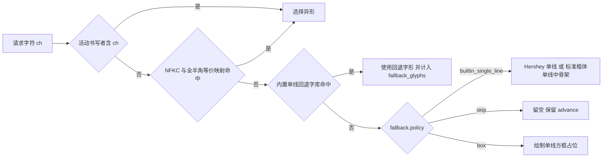

- 内置回退字库（随程序发行，`backend/handwrite/writers/fallback/`）：
  - `hershey_latin_greek_symbols.hwfont`：由公有领域 Hershey 单线字体转换，覆盖拉丁、希腊字母、数学运算符。
  - `std_kai_skeleton.hwfont`（可选）：标准楷体单线中轴骨架，仅在书写者缺字时兜底（需核验数据源授权，见 §20）。
- 回退结果在 `GET /layouts/{id}` 的 `pages[].fallback_glyphs` 中汇总（`[{char,count}]`），UI 给出缺字警告。

### 5.3 异形选择器 `VariantSelector`

| 策略 `variant_strategy` | 算法 |
|---|---|
| `random_no_repeat`（默认） | 对字符 ch 维护最近 `W=variant_no_repeat_window` 次所用异形队列；在不在队列中的候选里按 `weight × quality` 加权抽样；候选为空则退化为选择最久未用者 |
| `round_robin` | 按 `variant_no` 轮转 |
| `lru` | 始终选最久未用异形 |

随机源为 §11.1 的确定性分层 RNG，保证同 seed 重排结果完全一致。

---

## 6. 文档解析层：DOCX / PDF → 统一中间表示 DocIR

### 6.1 解析路由

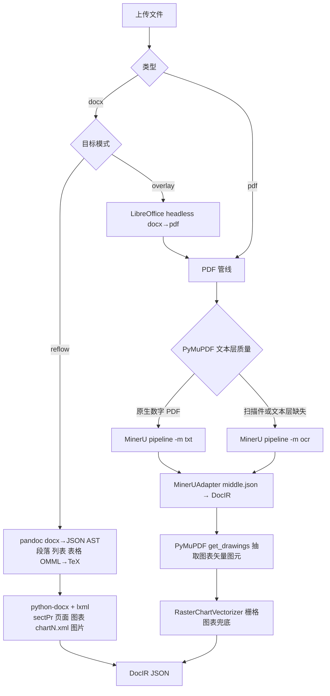

- DOCX 在 **重排模式** 下直接走结构化路径（无需 GPU，速度快、公式由 pandoc 精确转 TeX）。
- DOCX 在 **套打模式** 下先转 PDF（`soffice --headless --convert-to pdf`），以获得版面坐标，然后与 PDF 共用管线；同时保留 pandoc 解析出的公式 TeX，按文本相似度回填至 MinerU 公式块以提高公式准确率。
- 文档同时以 PyMuPDF 渲染每页 150 DPI PNG（`GET /documents/{doc_id}/pages/{n}/image`），用于套打底图。

### 6.2 DocIR JSON Schema（解析层唯一输出）

```json
{
  "$schema": "https://json-schema.org/draft/2020-12/schema",
  "$id": "https://handwrite.local/schema/docir.v1.json",
  "title": "DocIR",
  "type": "object",
  "required": ["doc_id", "source", "pages", "blocks"],
  "properties": {
    "doc_id": { "type": "string" },
    "source": {
      "type": "object",
      "required": ["type", "filename", "sha256"],
      "properties": {
        "type": { "enum": ["docx", "pdf"] },
        "filename": { "type": "string" },
        "sha256": { "type": "string" },
        "parser": { "type": "string", "examples": ["mineru-2.x/pipeline", "pandoc-3.1"] }
      }
    },
    "pages": {
      "type": "array",
      "items": {
        "type": "object",
        "required": ["page_index", "width_mm", "height_mm"],
        "properties": {
          "page_index": { "type": "integer", "minimum": 0 },
          "width_mm": { "type": "number" },
          "height_mm": { "type": "number" },
          "image": { "type": "string", "description": "相对路径 pages/0.png" }
        }
      }
    },
    "blocks": {
      "type": "array",
      "items": { "$ref": "#/$defs/Block" }
    }
  },
  "$defs": {
    "Inline": {
      "oneOf": [
        { "type": "object", "required": ["t", "text"], "properties": { "t": { "const": "text" }, "text": { "type": "string" }, "bold": { "type": "boolean" }, "italic": { "type": "boolean" } } },
        { "type": "object", "required": ["t", "latex"], "properties": { "t": { "const": "math" }, "latex": { "type": "string" } } },
        { "type": "object", "required": ["t"], "properties": { "t": { "const": "break" } } }
      ]
    },
    "Block": {
      "type": "object",
      "required": ["block_id", "type", "reading_order"],
      "properties": {
        "block_id": { "type": "string", "pattern": "^p\\d+-b\\d+$" },
        "page_index": { "type": ["integer", "null"] },
        "type": { "enum": ["heading", "paragraph", "list_item", "formula_block", "table", "figure", "chart", "caption", "header", "footer", "page_number", "discarded"] },
        "reading_order": { "type": "integer" },
        "bbox_mm": { "type": ["array", "null"], "items": { "type": "number" }, "minItems": 4, "maxItems": 4 },
        "lines": {
          "type": "array",
          "description": "套打模式：原始行框与行内容，用于逐行对位",
          "items": { "type": "object", "properties": { "bbox_mm": { "type": "array" }, "inlines": { "type": "array", "items": { "$ref": "#/$defs/Inline" } } } }
        },
        "inlines": { "type": "array", "items": { "$ref": "#/$defs/Inline" } },
        "latex": { "type": "string", "description": "formula_block 专用" },
        "table": {
          "type": "object",
          "properties": {
            "rows": { "type": "integer" }, "cols": { "type": "integer" },
            "col_widths_mm": { "type": "array", "items": { "type": "number" } },
            "cells": { "type": "array", "items": { "type": "object", "properties": {
              "r": { "type": "integer" }, "c": { "type": "integer" }, "rs": { "type": "integer" }, "cs": { "type": "integer" },
              "inlines": { "type": "array", "items": { "$ref": "#/$defs/Inline" } } } } }
          }
        },
        "chart": { "$ref": "#/$defs/ChartSpec" },
        "style": { "type": "object", "properties": { "level": { "type": "integer" }, "size_pt": { "type": "number" }, "align": { "enum": ["left", "center", "right", "justify"] } } },
        "confidence": { "type": "number", "minimum": 0, "maximum": 1 }
      }
    },
    "ChartSpec": {
      "type": "object",
      "required": ["kind", "origin"],
      "properties": {
        "kind": { "enum": ["bar", "hbar", "stacked_bar", "line", "pie", "scatter", "area", "unknown"] },
        "origin": { "enum": ["docx_xml", "pdf_vector", "raster"] },
        "title": { "type": "string" },
        "axes": { "type": "object", "properties": { "x_label": { "type": "string" }, "y_label": { "type": "string" }, "y_min": { "type": "number" }, "y_max": { "type": "number" }, "categories": { "type": "array", "items": { "type": "string" } } } },
        "series": { "type": "array", "items": { "type": "object", "properties": { "name": { "type": "string" }, "values": { "type": "array", "items": { "type": ["number", "null"] } } } } },
        "primitives": {
          "type": "array",
          "description": "无法语义化时的几何图元（页面 mm）",
          "items": { "type": "object", "properties": {
            "op": { "enum": ["polyline", "polygon", "rect", "ellipse", "text"] },
            "pts": { "type": "array", "items": { "type": "number" } },
            "fill": { "type": "boolean" }, "fill_key": { "type": "string" }, "text": { "type": "string" } } }
        }
      }
    }
  }
}
```

### 6.3 解析器接口

```python
ProgressCB = Callable[[str, float, int | None, int | None, str], None]  # (stage, pct, page, page_count, message)

class DocParser(Protocol):
    def supports(self, path: Path, mode: Literal["reflow", "overlay"]) -> bool: ...
    def parse(self, path: Path, *, doc_id: str, workdir: Path, progress: ProgressCB) -> DocIR: ...

class DocxStructuredParser(DocParser): ...   # pandoc + python-docx
class PdfMinerUParser(DocParser): ...        # 调用 MinerUWorker 子进程 + MinerUAdapter
class DocxViaPdfParser(DocParser): ...       # LibreOffice → PdfMinerUParser，并回填 OMML TeX
```

阶段 `stage` 与 UI 契约一致：`upload | convert | mineru_layout | mineru_ocr | mineru_formula | mineru_table | assemble | done | error`。

### 6.4 MinerU 输出 → DocIR 适配要点

| MinerU 元素（`middle.json` / `content_list.json`） | DocIR |
|---|---|
| `title` / `text` / `list` block | `heading` / `paragraph` / `list_item`，`lines[].bbox_mm` 由 PDF pt → mm（×25.4/72） |
| 行内 `inline_equation` span（LaTeX） | `Inline{t:"math"}` |
| `interline_equation` | `formula_block.latex` |
| `table`（HTML） | 用 lxml 解析 `<table>` → `table.cells`（含 rowspan/colspan） |
| `image` + `image_caption` | `figure`/`chart` + `caption`；图像先经图表分类器（§10.2）判定是否为图表 |
| `discarded`（页眉页脚页码） | `header/footer/page_number`，默认不写，可在套打中开启 |

### 6.5 DOCX 细节

- 页面：读取 `w:sectPr/w:pgSz`、`w:pgMar`（twip ÷ 56.6929 = mm），作为重排默认纸张与页边距建议值。
- 公式：pandoc 将 `m:oMath` 转为 TeX（`Math InlineMath/DisplayMath`），直接进入 §9。
- 图表：遍历 `word/charts/chartN.xml`（DrawingML Chart），读取 `c:barChart / c:lineChart / c:pieChart / c:scatterChart` 中 `c:cat`、`c:val` 的 `c:numCache/c:strCache` 缓存数据 → `ChartSpec(origin="docx_xml")`，无需任何图像识别，可精确重绘。
- 图片：普通照片类图片默认不写（UI 中可选择"转为单线素描"实验特性，后期）。

---

## 7. RTX 4070 Super 12GB 显存预算与 MinerU Pipeline 部署

### 7.1 约束与决策

- **必须使用 MinerU `pipeline` 后端**（`mineru -b pipeline`），**禁止** `vlm-vllm-engine` / `vlm-sglang-*` / `vlm-transformers` 等高显存 VLM 后端：vLLM 默认按比例预占显存（`gpu_memory_utilization`），会挤占桌面与浏览器 WebGL/Canvas 合成所需显存，且在 12GB 卡上与其他进程共存不稳定。
- pipeline 后端由多个小模型串联（版面检测、公式检测、公式识别、OCR、表格识别、阅读顺序），可逐模型按批推理，峰值可控。

### 7.2 显存预算表（目标峰值 ≤ 8 GB，余量 ≥ 4 GB）

> 以下为规划预算，P4 阶段须用 `nvidia-smi --query-gpu=memory.used --format=csv -lms 200` 对 50 页混排样本实测并回填本表。

| 组成 | 典型模型（MinerU 2.x pipeline） | 预算 | 说明 |
|---|---|---|---|
| CUDA Context + PyTorch 缓存分配器基线 | — | 0.6 GB | 每进程固定开销 |
| 版面检测 | DocLayout-YOLO | 0.8 GB | 按页批次 |
| 公式检测 MFD | YOLO 系列 | 0.5 GB | |
| 公式识别 MFR | UniMERNet 系列（显存大户） | 2.5 GB | 批大小随 `MINERU_VIRTUAL_VRAM_SIZE` 自适应 |
| OCR 检测 + 识别 | PaddleOCR（PyTorch 移植） | 1.2 GB | |
| 表格识别 | RapidTable / SLANet+ 等 | 1.2 GB | |
| 阅读顺序 | LayoutReader | 0.4 GB | |
| 激活峰值与碎片余量 | — | 0.8 GB | |
| **MinerU 子进程合计峰值** | | **≈ 8.0 GB** | 模型按阶段装载，实际峰值通常低于各项相加 |
| Windows/Linux 桌面合成 + 浏览器 GPU 进程 | — | 1.0–1.5 GB | 前端 Canvas 2D 硬件加速 |
| **安全余量** | | **≥ 2.5 GB** | 防止 OOM 与其他应用冲击 |

### 7.3 运行参数（`config/mineru.env`）

```ini
MINERU_MODEL_SOURCE=local            # 完全离线；模型由 `mineru-models-download` 预先下载
MINERU_DEVICE_MODE=cuda
MINERU_VIRTUAL_VRAM_SIZE=8           # 告知 pipeline 可用显存 (GB)，用于自适应批大小
PYTORCH_CUDA_ALLOC_CONF=expandable_segments:True
CUDA_VISIBLE_DEVICES=0
OMP_NUM_THREADS=8
```

调用命令（由 `MinerUWorker` 生成）：

```bash
mineru -p <chunk.pdf> -o <workdir>/mineru -b pipeline -m auto -l ch \
       --formula true --table true
```

### 7.4 MinerUWorker 子进程协议

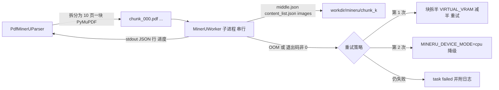

- **串行**：全局 GPU 信号量 `concurrency=1`；新的解析任务排队（UI 显示排队位次）。
- **分块**：每 10 页一块，既限制峰值显存，又提供细粒度进度（`page/page_count`）。
- **可取消**：取消任务即 `SIGTERM → 5s → SIGKILL` 子进程，显存随进程退出完全释放。
- **缓存**：以 `sha256(pdf) + mineru_version + 参数` 为键缓存解析结果，重复上传秒级返回。
- **依赖隔离**：MinerU 可安装在独立 venv（`runtime/mineru-venv`），通过可执行路径调用，避免与主进程 torch/numpy 版本冲突；主进程本身不依赖 torch。

---

## 8. 排版引擎：智能手写重排 与 原版坐标套打

### 8.1 核心数据结构

```python
@dataclass(slots=True)
class PenStroke:                      # 页面坐标中的一笔（单线、有向）
    pts: np.ndarray                   # float32 (N,2), mm
    kind: Literal["text", "formula", "table", "chart", "rule", "frame"]
    block_id: str | None
    reversible: bool                  # 字形笔画 False；表格/图表/剖面线 True
    order_group: int                  # 路径优化分组（同一行/同一图表）

@dataclass(slots=True)
class PageLayout:
    page_index: int; width_mm: float; height_mm: float
    strokes: list[PenStroke]          # 优化后即执行顺序
    fallback_glyphs: Counter[str]
    stats: PageStats                  # draw_mm, travel_mm, stroke_count, est_s

class Composer:
    def compose(self, doc: DocIR, writer: WriterHandle, cfg: LayoutConfig,
                profile: MachineProfile, progress: ProgressCB) -> list[PageLayout]: ...
```

排版为盒-胶（box & glue）模型：

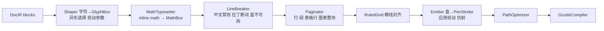

### 8.2 智能手写重排（mode = `reflow`）

1. **Shaper**：每个字符生成 `GlyphBox{advance_mm, ascent, descent, variant, perturb}`；CJK 全宽 `advance = font_size_mm × (1 + char_spacing)`，拉丁按字形 advance + kerning；空格宽 = 0.3 em。
2. **LineBreaker**（贪心 + 回溯一字的"挤压/推出"法）：
   - 行首禁则：`，。、；：？！）》」』】〉…—·%‰℃` 等不可居行首 → 前一字挤入（压缩字距 ≤ 15%）或推出。
   - 行尾禁则：`（《「『【〈“‘` 不可居行尾。
   - 拉丁单词与数字串不可拆（超长单词按字符断开）；行内公式 `MathBox` 默认不可拆，宽于行宽时在顶层关系符（`= < > \le \ge`）或二元运算符处拆分，再不行则等比缩小至 ≥ 70%。
   - 对齐：`justify` 时 CJK 字间均分余量；段末行左对齐。
3. **行高**：`line_pitch = max(font_size_mm × line_spacing, ruled.pitch_mm)`；若行内含高公式（如分式），行高按 `ceil(box_height / pitch)` 个格距扩展，保证基线始终落在横线上。
4. **横线/方格**（`text.ruled`）：`style=lines` 时基线对齐横线（基线在横线上方 `0.15 × pitch` 处，模拟真实书写）；`style=grid` 时 CJK 每字居中于方格；`draw=true` 时横线本身作为 `kind=rule` 笔画由机械臂画出（手绘抖动，见 §10.4）。
5. **分页**：段落可跨页（孤行/寡行控制：≥2 行）；表格按行拆分并重复表头；图表与独立公式整体不可拆，放不下时移至下页，前页余白不再回填（保持阅读顺序）。
6. **首行缩进**：`first_line_indent_chars` 个全宽字。

### 8.3 原版坐标套打（mode = `overlay`）

目标：在与原文档同尺寸的纸张上，把每个文本块用手写字迹写在原位置，以便与打印底稿/表格对齐。

1. **块级对位**：每块使用 `bbox_mm`（及 `lines[].bbox_mm`）作为排版框；若 `overlay.blocks[block_id].enabled == false` 则跳过；`nudge_mm{x,y}` 为该块微调平移。
2. **字号推定**：`font_size_mm = median(line_height_mm) × 0.92`；逐行在原行框内排写；若手写字宽导致行溢出，先压缩字距（≤ 15%），再整体缩小（≥ 70%），仍溢出则在行框下方续行并标记 `overflow` 警告。
3. **全局变换**：所有块排完后对整页施加 `T = Translate(offset_mm) · Rotate(rotation_deg, 页中心) · Scale(scale, 页中心)`，用于补偿纸张放置误差（与 UI 半透明底图拖拽对齐交互一一对应）。
4. **公式块、表格、图表**：在各自 bbox 内按 §9、§10 规则排布；表格优先复用 PDF 矢量表格线（`get_drawings`），其次使用 MinerU HTML 结构 + 等分列宽。
5. 底图透明度 `underlay_opacity` 仅影响前端渲染，不进入路径。

### 8.4 排版性能目标

- 纯文本 10 页 A4（约 8,000 字）：compose ≤ 3 s（8 核进程池按页并行：先串行完成断行/分页，再并行 Emit + 优化 + 编译）。
- 结果缓存键：`sha256(DocIR) + writer_id@version + sha256(canonical(LayoutConfig)) + profile_id`。

---

## 9. LaTeX 单线盒模型（数学公式排版）

### 9.1 总体流程

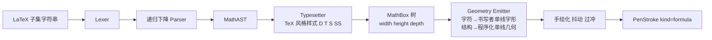

### 9.2 支持的 LaTeX 子集（v1）

| 类别 | 命令 |
|---|---|
| 原子 | 数字、拉丁字母（数学斜体由书写者字形 + 额外 8° 倾斜模拟）、希腊字母 `\alpha…\Omega`、`\infty \partial \nabla \hbar` |
| 运算/关系 | `+ - \times \div \pm \mp \cdot = \ne \approx \equiv \le \ge \ll \gg \sim \propto \in \notin \subset \subseteq \cup \cap \to \Rightarrow \Leftrightarrow` |
| 上下标 | `^ _`、`'` 撇号 |
| 分式/根式 | `\frac \dfrac \tfrac \sqrt[n]{}` |
| 大算子 | `\sum \prod \int \iint \oint \lim \max \min`（含 `\limits`/`\nolimits`） |
| 定界符 | `( ) [ ] \{ \} | \| \langle \rangle`、`\left…\right`、`\big…\Bigg` |
| 修饰 | `\overline \underline \hat \bar \vec \dot \ddot \tilde \overbrace \underbrace` |
| 环境 | `matrix pmatrix bmatrix vmatrix cases aligned array` |
| 文本与函数 | `\text{} \mathrm{} \sin \cos \tan \log \ln \exp` 等 |
| 间距 | `\, \: \; \quad \qquad \!` |

不支持的命令降级为 `\text{原始命令}` 并在任务警告中报告。

### 9.3 盒模型定义

```python
@dataclass(slots=True)
class MathBox:
    width: float          # em（相对当前样式字号）
    height: float         # 基线以上
    depth: float          # 基线以下
    items: list[tuple[float, float, "MathBox | GlyphRef | Geom"]]  # (dx, dy) 相对于本盒基线原点
    italic_corr: float = 0.0
    kind: Literal["ord", "op", "bin", "rel", "open", "close", "punct", "inner"] = "ord"
```

- **样式**：`D`（display）、`T`（text）、`S`（script, ×0.70）、`SS`（scriptscript, ×0.50），遵循 TeX 样式变换规则（分子 D→T，上标 T→S 等）。
- **原子间距**：沿用 TeX 原子类型间距表（thin=3/18 em, medium=4/18 em, thick=5/18 em；S/SS 样式下除 thin 外置零）。
- **公式度量参数（`MathParams`，单位 em，可在 `formula.scale` 之外按书写者微调）**：

| 参数 | 值 | 含义 |
|---|---|---|
| `axis_height` | 0.25 | 数学轴（分数线、`+` 中心）距基线高度 |
| `sup_shift` | 0.42 (D 0.48) | 上标抬升 |
| `sub_shift` | 0.18 (有上标时 0.24) | 下标下沉 |
| `num_gap` / `den_gap` | 0.12 / 0.12 | 分子/分母与分数线间隙 |
| `frac_ext` | 0.08 | 分数线两端外伸 |
| `radical_gap` | 0.10 | 根号顶线与被开方式间隙 |
| `big_op_scale` | D 1.6 / T 1.15 | 大算子缩放 |
| `limits_gap` | 0.10 | 上下限间距 |
| `delim_factor` | 0.90 | `\left…\right` 定界符覆盖率 |
| `matrix_col_gap` / `row_gap` | 0.8 / 0.35 | 矩阵间距 |

### 9.4 结构单线几何（程序化生成，输出单位 em，随后缩放到 mm）

| 结构 | 单线几何生成 |
|---|---|
| 分数线 | 一条水平折线（6–10 点），施加幅度 0.008 em 的低频噪声，长度 = max(分子,分母)+2×`frac_ext` |
| 根号 | 一笔连续折线：短上挑（0.15em）→ 下折到 depth → 斜上至顶线左端 → 顶线向右至被开方式右端 +0.05em；`[n]` 指数置于钩部左上 S/SS 样式 |
| 圆括号 `( )` | 高度 h 的椭圆弧单笔（参数化 θ∈[110°,250°]），宽度 = 0.18 + 0.06·log2(h/1em) |
| 方括号 `[ ]` / 竖线 | 三段/单段折线，转角处 0.02em 圆角 |
| 花括号 `\{ \}` | 两段三次贝塞尔拼接的单笔，中点尖角朝外 |
| 积分号 `\int` | 参数化 S 形曲线单笔（上钩—斜长干—下钩），高 = D 2.2em / T 1.4em；`\iint` 并排、`\oint` 叠加小椭圆 |
| 求和/连乘 `\sum \prod` | 优先使用书写者 `Σ`/`Π` 字形按 `big_op_scale` 放大；缺字则程序化生成单笔折线 |
| 上横线/向量箭头/帽子 | 折线；箭头为主线 + 两短笔 |
| 矩阵定界 | 同括号/方括号，按矩阵总高度拉伸 |
| 字符（数字/字母/运算符） | **统一调用当前书写者的单线字形**（经 §5.2 回退链），使公式与正文笔迹一致 |

### 9.5 与正文的融合

- 行内公式：`MathBox` 作为普通盒参与断行；其基线与正文基线对齐，`height/depth` 计入行高；`formula.scale`（0.6–1.2）作用于公式 em 相对正文 em 的比例。
- 独立公式（`formula_block`）：居中，前后各加 `0.5 × line_pitch` 间距；超宽时在顶层关系符处换行并左对齐续行。
- 公式笔画同样接受 §11 扰动，但缩放抖动幅度降为正文的 50%、基线波动置零（防止上下标错位影响可读性）。

---

## 10. 表格与图表：手绘单线 + 剖面线填充流水线

### 10.1 表格

1. 结构来源优先级：PDF 矢量表格线 > DOCX/MinerU 结构 + 列宽 > 等分。
2. 表格线：每条线段按 §10.4 手绘化（`table.hand_jitter_mm`），水平线自左向右、竖线自上向下书写；相交处故意 0.3 mm 过冲以模拟手绘。`draw_borders=false` 时只写内容。
3. 单元格内容：在单元格内框（内边距 1 mm）中按重排规则写入，自动缩小字号至 ≥ 70% 以适配。

### 10.2 图表流水线

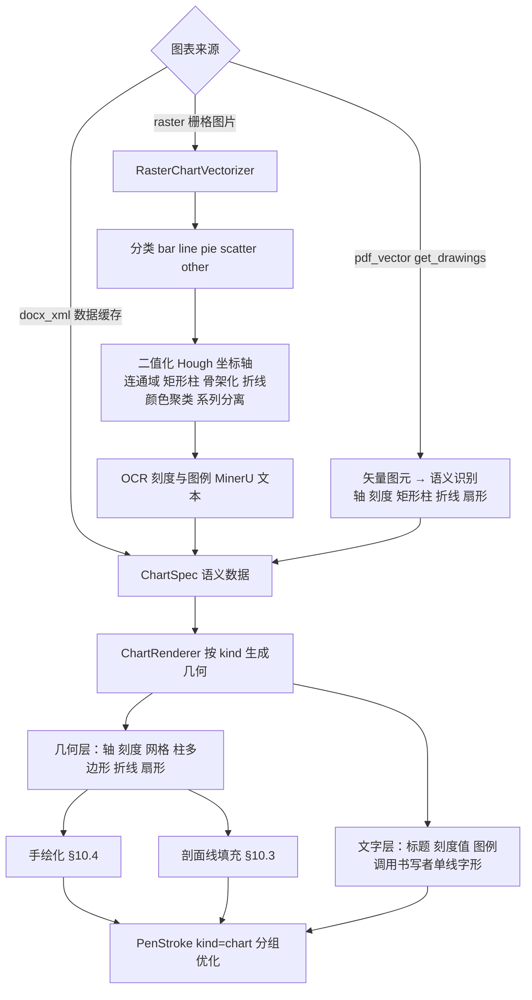

- 若语义识别失败（`kind=unknown`），直接以 `primitives` 几何绘制：描边手绘化，填充区域（`fill=true`）做剖面线。
- 系列区分（单色笔无法用颜色）：系列 i 使用不同剖面样式：`angle = hatch_angle_deg + i×45°`，i≥4 时改为 `cross`；折线系列用不同端点标记（○ △ □ ×，单线绘制）；图例同步绘制样式小样。

### 10.3 剖面线（Hatching）算法

输入：多边形（可带孔，shapely `Polygon`），间距 `s = chart.hatch_spacing_mm`（0.8–5），角度 θ，样式 `parallel | cross | zigzag`，笔宽 `w`（默认 0.5 mm）。

1. 内缩：`P' = P.buffer(-w/2)`，避免剖面线越界。
2. 旋转：将 `P'` 绕质心旋转 −θ，使剖面线水平。
3. 扫描：在 `y = y_min + s/2 + k·s` 处与 `P'` 求交，得到每条扫描线上的若干线段（偶奇规则，自动处理孔洞与凹多边形）。
4. 连接：
   - `parallel`：线段按 **蛇形（boustrophedon）** 交替方向输出，相邻线段端点距离 < 1.5 s 且连线完全位于 `P'` 内时合并为一笔（落笔沿边界连接），否则抬笔。
   - `zigzag`：相邻扫描线段首尾相连形成连续"之"字单笔（最少抬笔，最具手绘感）。
   - `cross`：θ 与 θ+90° 各执行一次。
5. 回转 +θ，手绘化（幅度 `0.5 × hand_jitter_mm`），每条剖面线端点随机回缩 0–0.3 s，模拟手绘不齐。
6. 输出笔画 `reversible=True`，交由 §13 优化顺序与方向。

### 10.4 手绘化（Hand-drawn）通用变换

对任一折线 `L`：
1. 等弧长重采样（步长 1 mm）。
2. 法向位移 `n(t) = A · noise1d(t / λ + φ)`，`A = hand_jitter_mm`，`λ = 25 mm`，`noise1d` 为种子化值噪声（平滑、无高频，避免机械臂抖动）。
3. 起止端各施加 `U(0, 0.4) mm` 过冲/欠冲；长直线中段叠加 `≤ 0.2°` 的整体轻微弯曲。
4. Ramer–Douglas–Peucker 简化（`optimize.simplify_tol_mm`）后输出。

---

## 11. 拟人扰动模型

### 11.1 确定性分层随机源

```python
rng(scope) = numpy.random.Generator(PCG64(SeedSequence([seed, hash32(scope...)])))
# scope 例：("glyph", page_index, line_index, glyph_seq) / ("line", page_index, line_index) / ("hatch", block_id, k)
```

同一 `perturb.seed` + 相同输入 ⇒ 完全相同的输出；修改某一段文字只影响该段之后的局部随机序列（以行为作用域，避免"蝴蝶效应"导致全页变化）。

### 11.2 扰动变量与公式

| 参数（`perturb.*`） | 范围 | 作用 | 公式 |
|---|---|---|---|
| `scale_jitter` | 0–0.3 | 逐字缩放 | `s_i = 1 + clip(N(0, j/2), −j, +j)`，以字面框底部中心为锚（CJK）/基线为锚（拉丁） |
| `slant_deg` | 0–8 | 倾斜 | 行级基调 `β_line = slant_deg · U(0.6, 1.0)`；逐字 `θ_i = β_line + N(0, 0.25·slant_deg)`；剪切 `x' = x + tan θ_i · (y_base − y)` |
| `rotation_jitter_deg` | 0–5 | 逐字微旋 | `r_i = N(0, σ)`，绕字心 |
| `baseline_wave_amp_mm` / `_period_mm` | 0–1.5 / 20–200 | 基线波动 | `Δy(x) = A·sin(2πx/P + φ_line) + AR1_i`，`AR1_i = 0.7·AR1_{i−1} + N(0, 0.15A)`，并以 `±A` 截断 |
| `spacing_jitter` | 0–0.3 | 字距抖动 | `adv_i' = adv_i · (1 + U(−k, k))`，行内累计误差在行末回收（保持对齐） |
| `variant_strategy` / `variant_no_repeat_window` | — / 1–16 | 同字异形调度 | 见 §5.3 |

### 11.3 约束

- **防碰撞**：扰动后字形 bbox 与相邻字形重叠面积 > 8% 时，将该字缩放回退一半。
- **字内一致**：扰动只施加整体仿射（缩放/剪切/旋转/平移），不对笔画点做独立高频噪声，避免机械臂抖动与"抖笔"假象（真实书写的细节已经包含在异形字形中）。
- **作用域差异**：公式缩放扰动 ×0.5、基线波动 ×0；表格单元格内基线波动 ×0.5；标题字号放大时扰动按比例不变（相对值）。
- 全部仿射合成为单个 `3×3` 矩阵在 Emitter 阶段一次性作用于字形点（`numpy` 向量化）。

---

## 12. 接口契约：REST + WebSocket + JSON Schema

> 本节为前后端唯一契约（Contract v1），与 `docs/ui_design.md` 100% 对齐。
> 基础地址：`http://127.0.0.1:8765`；REST 前缀 `/api/v1`；WebSocket：`ws://127.0.0.1:8765/ws/telemetry`。
> 所有数值坐标单位为 `mm`（JSON 保留 2 位小数），页码为 0 基 `page_index`，错误响应统一为 `{"error": {"code": str, "message": str, "details": dict | null}}`。

### 12.1 状态枚举

```python
class MachineState(StrEnum):
    DISCONNECTED = "DISCONNECTED"   # 未连接串口
    CONNECTING   = "CONNECTING"     # 正在打开串口并同步 GRBL 状态
    IDLE         = "IDLE"           # 已连接且空闲
    JOGGING      = "JOGGING"        # 点动中 ($J=)
    FRAMING      = "FRAMING"        # 外框边界试跑中
    RUNNING      = "RUNNING"        # 正在流式写字
    HOLDING      = "HOLDING"        # 已发送 !，等待机械臂减速至 Hold:0
    PAUSED       = "PAUSED"         # 已完全停止并抬笔，等待续写或换笔
    PEN_CHANGE   = "PEN_CHANGE"     # 已移动至换笔位并抬笔，等待用户换笔后点击续写
    PAPER_CHANGE = "PAPER_CHANGE"   # 单页完成，已退回原位并抬笔，等待换纸确认
    ALARM        = "ALARM"          # GRBL 报警态（软限位/硬限位等），需 $X 解锁
    ESTOPPED     = "ESTOPPED"       # 急停后锁定态（已发 0x18 + 抬笔），需人工确认解锁
    ERROR        = "ERROR"          # 串口断开、协议不可恢复错误

# 原生 GRBL 状态透传（来自 ? 响应 <State|...>）
GrblState = Literal["Idle", "Run", "Hold:0", "Hold:1", "Jog", "Alarm", "Door", "Check", "Home", "Sleep"]

class JobState(StrEnum):
    QUEUED     = "QUEUED"
    PREPARING  = "PREPARING"
    STREAMING  = "STREAMING"
    PAUSED     = "PAUSED"
    PEN_CHANGE = "PEN_CHANGE"
    WAIT_PAPER = "WAIT_PAPER"
    COMPLETED  = "COMPLETED"
    ABORTED    = "ABORTED"
    FAILED     = "FAILED"

TaskKind  = Literal["parse", "compose", "font_import"]
TaskState = Literal["pending", "running", "done", "failed"]
```

### 12.2 REST 端点表（前缀 `/api/v1`）

| 分组 | 方法与路径 | 请求体 / 查询参数 | 响应体摘要 |
|---|---|---|---|
| **系统** | `GET /health` | — | `{status:"ok", version, contract_version:1, gpu:{available, name, vram_free_mb}}` |
| | `GET /tasks/{task_id}` | — | `{task_id, kind, state, stage, pct, page?, page_count?, message, result?, error?}` |
| **书写者** | `GET /writers` | — | `{active_writer_id, writers:[HwFontMeta...]}` |
| | `POST /writers` | `multipart/form-data` (`file`: `.hwfont`) | `{writer: HwFontMeta}` 或 `{task_id}`（大文件校验） |
| | `GET /writers/active` | — | `{writer: HwFontMeta \| null}` |
| | `POST /writers/active` | `{writer_id}` | `{active_writer_id}`（并广播 WS `writer.changed`） |
| | `GET /writers/{writer_id}/glyphs/{char}` | `?all_variants=1` | `{char, codepoint, variants:[{variant_id, variant_no, source, quality, weight, advance, bbox:[x0,y0,x1,y1], strokes:[[x0,y0,...]]}]}` |
| | `GET /writers/{writer_id}/coverage` | `?doc_id=<id>` | `{total_chars, unique_chars, covered, missing:[{char, count, fallback_available}]}` |
| | `DELETE /writers/{writer_id}` | — | `{deleted: true}`（被活动或运行中任务占用返回 409） |
| **文档** | `POST /documents` | `multipart/form-data` (`file`: `.docx\|.pdf`, `mode_hint?`) | `202 {doc_id, task_id}` |
| | `GET /documents/{doc_id}` | — | `{doc_id, source, page_count, pages:[{page_index, width_mm, height_mm}], status}` |
| | `GET /documents/{doc_id}/blocks` | `?page_index=<n>` | `{doc_id, blocks:[DocIR.Block...]}` |
| | `GET /documents/{doc_id}/pages/{page_index}/image` | — | `image/png`（150 DPI 套打底图） |
| **排版** | `GET /layout/defaults` | `?doc_id=<id>` | `{config: LayoutConfig}` |
| | `POST /layouts` | `{doc_id, writer_id, config: LayoutConfig}` | `202 {layout_id, task_id}` |
| | `GET /layouts/{layout_id}` | — | `{layout_id, writer_id, doc_id, page_count, config, pages:[{page_index, width_mm, height_mm, bbox:[x0,y0,x1,y1], stats, fallback_glyphs:[{char, count}]}]}` |
| | `GET /layouts/{layout_id}/pages/{page_index}/paths` | `?format=json\|f32`（默认 `json`） | `json` 或二进制 `application/octet-stream`（见 §12.3） |
| | `GET /layouts/{layout_id}/pages/{page_index}/gcode` | — | `text/plain`（下载本页 G-code） |
| **硬件** | `GET /machine/ports` | — | `{ports:[{device, description, hwid, vid, pid}]}` |
| | `GET /machine/profiles` | — | `{active_profile_id, profiles:[MachineProfile...]}` |
| | `PUT /machine/profiles/{profile_id}` | `MachineProfile` | `{profile: MachineProfile}` |
| | `POST /machine/connect` | `{port, baud, profile_id, mock: bool}` | `{machine_state, profile_id, mock}` |
| | `POST /machine/disconnect` | — | `{machine_state:"DISCONNECTED"}` |
| | `POST /machine/jog` | `{dx, dy, feed}` | `{accepted: true}` |
| | `POST /machine/jog/cancel` | — | `{accepted: true}` |
| | `POST /machine/zero` | `{axes:["X","Y"]}` | `{wpos:{x,y,z}}`（下发 `G92 X0 Y0`） |
| | `POST /machine/pen` | `{state:"up"\|"down"}` | `{pen:"up"\|"down"}` |
| | `POST /machine/frame` | `{layout_id, page_index}` | `{machine_state:"FRAMING", bbox:[x0,y0,x1,y1]}` |
| | `POST /machine/unlock` | — | `{machine_state:"IDLE"}`（发送 `$X` + 强制抬笔） |
| | `POST /machine/estop` | — | `{machine_state:"ESTOPPED"}`（优先通道 `0x18` + 抬笔） |
| **任务** | `POST /jobs` | `{layout_id, page_indices:[...], start_page_index:0}` | `201 {job_id, job_state}` |
| | `GET /jobs/{job_id}` | — | `{job_id, layout_id, job_state, page_indices, current_page_index, progress}` |
| | `POST /jobs/{job_id}/pause` | — | `{job_state, machine_state}` |
| | `POST /jobs/{job_id}/resume` | — | `{job_state, machine_state}` |
| | `POST /jobs/{job_id}/pen-change` | — | `{job_state:"PEN_CHANGE", machine_state:"PEN_CHANGE"}` |
| | `POST /jobs/{job_id}/paper-ready` | `{page_index}` | `{job_state:"STREAMING", page_index}` |
| | `POST /jobs/{job_id}/abort` | — | `{job_state:"ABORTED"}`（抬笔并回原点） |

### 12.3 路径数据格式（`GET /layouts/{id}/pages/{page_index}/paths`）

**1) `format=json`（调试与按块交互）**：

```json
{
  "layout_id": "ly_9f2a1c",
  "page_index": 0,
  "width_mm": 210.0,
  "height_mm": 297.0,
  "bbox": [24.80, 29.40, 185.12, 268.30],
  "strokes": [
    { "id": 0, "block_id": "p0-b0", "kind": "text", "pts": [25.10, 32.00, 26.40, 32.15, 28.00, 31.90] }
  ],
  "stats": { "draw_mm": 4820.5, "travel_mm": 1910.2, "stroke_count": 3420, "est_s": 215.4 }
}
```

- `strokes` 数组顺序即优化后的最终执行顺序；任意相邻两笔之间（上一笔末点 → 下一笔首点）即为一次空移（travel）。

**2) `format=f32`（高性能 Canvas 2D 渲染默认格式）**：

- `Content-Type: application/octet-stream`，响应头携带 `X-Page-Width-Mm`、`X-Page-Height-Mm`、`X-Bbox`（`x0,y0,x1,y1`）、`X-Stroke-Count`、`X-Seg-Count`。
- 正文为连续小端 IEEE-754 `Float32` 三元组 `(x_mm, y_mm, flag)`，每顶点 12 字节，100k 顶点仅 1.2 MB，浏览器可直接 `new Float32Array(buf)` 零拷贝消费：
  - `flag = 0.0`：`travel-to`（抬笔移动至 `(x, y)`，开启新笔画起点）
  - `flag = 1.0`：`draw-to`（落笔直线绘至 `(x, y)`）
  - `flag = 2.0`：`draw-to & stroke boundary`（落笔绘至 `(x, y)` 且标志本笔画结束，便于进度回放与笔尖高亮按 `stroke_index` 切片）

### 12.4 WebSocket 协议（`ws://127.0.0.1:8765/ws/telemetry`）

统一信封：

```json
{ "v": 1, "type": "<event_type>", "seq": 1024, "ts": 1732300000123, "data": { ... } }
```

**Server → Client 事件**：

| `type` | 频率 / 触发 | `data` 载荷 |
|---|---|---|
| `machine.status` | ~10 Hz（空闲时可降频至 2 Hz） | `{machine_state, job_state: str\|null, grbl_state, mpos:{x,y,z}, wpos:{x,y,z}, feed: float, pen:"up"\|"down", buf:{planner:int, rx:int}, alarm_code:int\|null, mock:bool}` |
| `job.progress` | ~5 Hz（仅运行中） | `{job_id, job_state, page_index, page_count, stroke_index, stroke_total, seg_index, seg_total, line_acked, line_total, pct, pen_xy:{x,y}, elapsed_s, eta_s, draw_mm, travel_mm}` |
| `job.event` | 状态跃迁即推 | `{job_id, event:"started"\|"paused"\|"pen_change_ready"\|"resumed"\|"page_done"\|"paper_change_required"\|"job_done"\|"aborted"\|"failed"\|"alarm"\|"estop", page_index:int, code?:int, message:str}` |
| `task.progress` | 阶段/每块推进即推 | `{task_id, kind:"parse"\|"compose"\|"font_import", state:"pending"\|"running"\|"done"\|"failed", stage:str, pct:float, page?:int, page_count?:int, message:str}` |
| `writer.changed` | 切换活动书写者时 | `{writer_id:str}` |
| `alarm` | 软限位/硬限位/串口/校验异常 | `{code:str\|int, message:str, severity:"info"\|"warn"\|"critical"}` |
| `serial.log` | 串口收发（前端开启调试面板订阅） | `{dir:"tx"\|"rx", line:str}` |

**Client → Server 指令**：

- `ping` `{}` → 服务端回复 `pong` `{ts}`
- `jog` `{dx, dy, feed}`（与 REST 冗余，键盘连按低延迟）
- `jog.cancel` `{}`（发送 GRBL `0x85` 实时点动取消）
- `estop` `{}`（与 REST 冗余，任意通道到达立即触发最高优先级急停）
- `subscribe` `{serial_log: bool}`（默认 `false`，减少串口日志带宽）

### 12.5 `LayoutConfig` JSON Schema

```json
{
  "$schema": "https://json-schema.org/draft/2020-12/schema",
  "$id": "https://handwrite.local/schema/layout-config.v1.json",
  "title": "LayoutConfig",
  "type": "object",
  "required": ["mode", "page", "text", "perturb", "formula", "chart", "table", "overlay", "optimize", "fallback"],
  "properties": {
    "mode": { "enum": ["reflow", "overlay"] },
    "page": {
      "type": "object",
      "required": ["size", "width_mm", "height_mm", "orientation", "margins_mm"],
      "properties": {
        "size": { "enum": ["A4", "A5", "B5", "Letter", "custom"] },
        "width_mm": { "type": "number", "minimum": 50, "maximum": 600 },
        "height_mm": { "type": "number", "minimum": 50, "maximum": 600 },
        "orientation": { "enum": ["portrait", "landscape"] },
        "margins_mm": {
          "type": "object",
          "required": ["top", "right", "bottom", "left"],
          "properties": {
            "top": { "type": "number", "minimum": 0 }, "right": { "type": "number", "minimum": 0 },
            "bottom": { "type": "number", "minimum": 0 }, "left": { "type": "number", "minimum": 0 }
          }
        }
      }
    },
    "text": {
      "type": "object",
      "properties": {
        "font_size_mm": { "type": "number", "minimum": 3.0, "maximum": 30.0, "default": 6.0 },
        "line_spacing": { "type": "number", "minimum": 1.0, "maximum": 3.0, "default": 1.5 },
        "char_spacing": { "type": "number", "minimum": -0.2, "maximum": 1.0, "default": 0.05 },
        "paragraph_spacing_mm": { "type": "number", "minimum": 0, "maximum": 30, "default": 3.0 },
        "first_line_indent_chars": { "type": "number", "minimum": 0, "maximum": 8, "default": 2 },
        "align": { "enum": ["left", "justify", "center", "right"], "default": "justify" },
        "ruled": {
          "type": "object",
          "properties": {
            "style": { "enum": ["none", "lines", "grid"], "default": "none" },
            "pitch_mm": { "type": "number", "minimum": 5, "maximum": 25, "default": 9.0 },
            "draw": { "type": "boolean", "default": false }
          }
        }
      }
    },
    "perturb": {
      "type": "object",
      "properties": {
        "seed": { "type": "integer", "minimum": 0, "maximum": 4294967295, "default": 42 },
        "scale_jitter": { "type": "number", "minimum": 0, "maximum": 0.3, "default": 0.08 },
        "slant_deg": { "type": "number", "minimum": 0, "maximum": 8.0, "default": 2.5 },
        "baseline_wave_amp_mm": { "type": "number", "minimum": 0, "maximum": 1.5, "default": 0.45 },
        "baseline_wave_period_mm": { "type": "number", "minimum": 20, "maximum": 200, "default": 75.0 },
        "spacing_jitter": { "type": "number", "minimum": 0, "maximum": 0.3, "default": 0.08 },
        "rotation_jitter_deg": { "type": "number", "minimum": 0, "maximum": 5.0, "default": 1.2 },
        "variant_strategy": { "enum": ["random_no_repeat", "round_robin", "lru"], "default": "random_no_repeat" },
        "variant_no_repeat_window": { "type": "integer", "minimum": 1, "maximum": 16, "default": 3 }
      }
    },
    "formula": {
      "type": "object",
      "properties": {
        "scale": { "type": "number", "minimum": 0.6, "maximum": 1.2, "default": 0.95 },
        "stroke_style": { "enum": ["handwrite"], "default": "handwrite" }
      }
    },
    "chart": {
      "type": "object",
      "properties": {
        "hatch_spacing_mm": { "type": "number", "minimum": 0.8, "maximum": 5.0, "default": 1.8 },
        "hatch_angle_deg": { "type": "number", "minimum": -90, "maximum": 90, "default": 45.0 },
        "hatch_style": { "enum": ["parallel", "cross", "zigzag"], "default": "parallel" },
        "hand_jitter_mm": { "type": "number", "minimum": 0, "maximum": 1.0, "default": 0.25 }
      }
    },
    "table": {
      "type": "object",
      "properties": {
        "draw_borders": { "type": "boolean", "default": true },
        "hand_jitter_mm": { "type": "number", "minimum": 0, "maximum": 1.0, "default": 0.20 }
      }
    },
    "overlay": {
      "type": "object",
      "properties": {
        "offset_mm": { "type": "object", "properties": { "x": { "type": "number", "default": 0 }, "y": { "type": "number", "default": 0 } } },
        "scale": { "type": "number", "minimum": 0.5, "maximum": 1.5, "default": 1.0 },
        "rotation_deg": { "type": "number", "minimum": -10, "maximum": 10, "default": 0.0 },
        "underlay_opacity": { "type": "number", "minimum": 0, "maximum": 1, "default": 0.35 },
        "blocks": {
          "type": "object",
          "additionalProperties": {
            "type": "object",
            "properties": {
              "enabled": { "type": "boolean", "default": true },
              "nudge_mm": { "type": "object", "properties": { "x": { "type": "number", "default": 0 }, "y": { "type": "number", "default": 0 } } }
            }
          }
        }
      }
    },
    "optimize": {
      "type": "object",
      "properties": {
        "travel": { "enum": ["greedy_2opt", "none"], "default": "greedy_2opt" },
        "simplify_tol_mm": { "type": "number", "minimum": 0.02, "maximum": 0.5, "default": 0.08 },
        "join_tol_mm": { "type": "number", "minimum": 0.0, "maximum": 1.0, "default": 0.15 }
      }
    },
    "fallback": {
      "type": "object",
      "properties": {
        "policy": { "enum": ["builtin_single_line", "skip", "box"], "default": "builtin_single_line" }
      }
    }
  }
}
```

### 12.6 `MachineProfile` 与 `HwFontMeta` Schema

```json
{
  "MachineProfile": {
    "profile_id": "default-corexy-servo",
    "name": "A4 CoreXY 舵机写字机",
    "baud": 115200,
    "pen": {
      "mode": "servo",
      "servo_up": "M5",
      "servo_down": "M3 S90",
      "dwell_ms": 120,
      "z_up_mm": 4.0,
      "z_down_mm": 0.0,
      "z_feed": 1200
    },
    "workspace_mm": { "x": 220.0, "y": 310.0 },
    "pen_change_pos_mm": { "x": 10.0, "y": 10.0 },
    "paper_change_pos_mm": { "x": 0.0, "y": 0.0 },
    "origin": "top_left",
    "invert_x": false,
    "invert_y": false,
    "feed_draw": 2400,
    "feed_travel": 5000,
    "jog_feed": 3000,
    "status_hz": 10,
    "rx_buffer": 128
  }
}
```

> `HwFontMeta` 字段列表与 §4.3 表格完全一致：`format_version, writer_id, writer_name, writer_alias, author, version, style_tags, units_per_em, baseline_y, x_height, cap_height, default_advance, glyph_count, variant_count, coverage:{cjk,latin,digit,punct,symbol}, builder, model, created_at, license, preview_text, preview_char, content_sha256`。

---

## 13. 路径优化与 G-code 编译

### 13.1 路径优化（`PathOptimizer`）

| 步骤 | 规则与约束 |
|---|---|
| 1. 折线简化 | Ramer–Douglas–Peucker（`simplify_tol_mm`，默认 0.08 mm），过滤零长段与重复点 |
| 2. 边界裁剪 | 校验所有点落入 `MachineProfile.workspace_mm`；超界返回错误并标出越界块，**绝不静默截断下发硬件** |
| 3. 笔顺保护 | `reversible=False` 的笔画（所有字形笔画）**禁止反转且在字内严禁重排**，保证视觉与书写笔顺真实自然 |
| 4. 分组空移优化 | 文本行按自然阅读序从上到下、从左到右输出（便于用户中途观察与纠错）；仅在**表格边框、图表几何、剖面线**分组内部执行 `greedy_2opt` 最近邻 + 2-opt 局部交换（对 `reversible=True` 的线段允许首尾互换），通常可减少 40–65% 图表空移 |
| 5. 同笔衔接 | 同一 `reversible=True` 组内，若前笔终点与后笔起点距离 ≤ `join_tol_mm`（默认 0.15 mm），合并为一笔省去抬笔/落笔驻留 |

### 13.2 G-code 编译（`GcodeCompiler`）

**页首序言（Preamble）**：
```gcode
G21                  ; 毫米模式
G90                  ; 绝对坐标
G17                  ; XY 平面
G94                  ; 每分钟进给
<PEN_UP>             ; 确保抬笔开始（舵机 M5；Z 轴 G0 Z4.0）
G4 P0.12             ; 抬笔驻留 (dwell_ms / 1000)
```

**单笔画模板**：
```gcode
G0 X25.100 Y32.000 F5000     ; 空移至起点（状态：抬笔）
<PEN_DOWN>                   ; 舵机 M3 S90；Z 轴 G1 Z0.000 F1200
G4 P0.12                     ; 落笔驻留，待笔尖稳定触纸
G1 X26.400 Y32.150 F2400     ; 仅首段带 F，后续省略冗余模态词
X28.000 Y31.900
<PEN_UP>
G4 P0.12
```

**页尾收尾（Epilogue）**：
```gcode
<PEN_UP>
G4 P0.12
G0 X0.000 Y0.000 F5000       ; 退至 paper_change_pos_mm，让出纸面便于换纸
```

**优化与行映射**：
- 省略模态冗余字段（连续 `G1`、未变化的 `X`/`Y`/`F`），每行长度严格 ≤ 64 字节（远小于 GRBL 80 字符行上限）。
- 编译同时生成**行号↔笔画索引映射表** `line_map`（紧凑整数数组 `line_to_stroke[line_no]`、`stroke_to_start_line[stroke_idx]`），供：
  1. 实时 `job.progress` 精确回推当前 `stroke_index` 与 `pen_xy`；
  2. 断电/急停后按**完整笔画边界**恢复（见 §15.3）。
- **时间估算**：按梯形加速度估算每段耗时（默认保守加速度 `a=500 mm/s²`）+ 抬落笔次数 × `2 × dwell_ms`，供 UI 显示 `est_s` 与 `eta_s`。

---

## 14. GRBL 通信、流式传输与安全协议

### 14.1 状态机

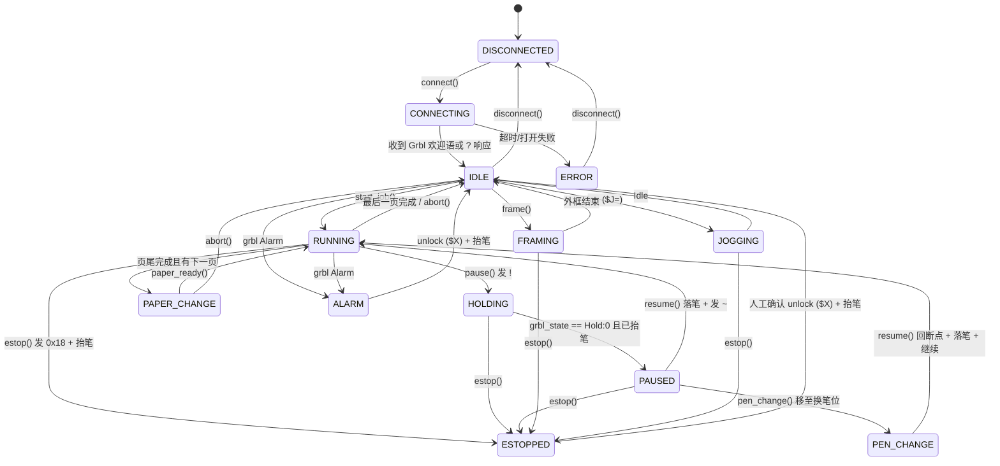

### 14.2 GRBL 1.1 字符计数流式协议（Character-Counting Protocol）

禁止使用低吞吐的"一问一答（Send-Response）"模式（在短线段密集的汉字笔迹中会导致步进电机严重顿挫、笔尖渗墨）。采用 GRBL 官方推荐的 **RX 缓冲字符计数流控**：

```python
class GrblStreamer:
    rx_budget: int            # 来自 MachineProfile.rx_buffer，默认 128（保守取 120 留余量）
    in_flight: deque[tuple[int, int]]   # (line_no, byte_len_incl_lf)
    bytes_in_flight: int = 0
```

- **发送条件**：仅当 `bytes_in_flight + len(next_line) <= rx_budget - 8` 且未处于暂停/急停时写入下一行（`\n` 结尾，剥离注释与多余空格）。
- **确认回收**：每收到一行 `ok`，弹出队首 `(line_no, n)`，`bytes_in_flight -= n`，推进 `acked_line = line_no`；收到 `error:N` 时立即进入 `HOLDING`/`ALARM` 并上报具体行号与 GRBL 错误释义。
- **实时单字节命令**（不带换行、**不计入** `bytes_in_flight`、经串口 IO 线程优先队列插队发送）：
  - `?`（状态查询，10 Hz）
  - `!`（Feed Hold，减速暂停）
  - `~`（Cycle Start，恢复）
  - `0x18`（Ctrl-X 软复位）
  - `0x85`（Jog Cancel）
- 启动连接时启用缓冲报告：检查 `$10` 位掩码包含位 1（Buffer data），解析 `<Run|MPos:...|WCO:...|Bf:15,128|FS:2400,90>`。

### 14.3 核心安全操作序列

#### A. 抬笔默认安全（Fail-Safe 硬件约定）
- **舵机模式**：要求固件/接线满足 **`M5`（PWM 0 / 主轴停）= 抬笔**，**`M3 S<down>` = 落笔**。这样 GRBL 一旦软复位（`0x18`）、触发报警（Alarm）或上电初始化，主轴默认停止即自动抬笔，绝不会将笔尖压断或拖黑纸面。`MachineProfile` 保存校验时若检测到 `servo_up` 非 `M5` 会发出强警告。
- **Z 轴步进模式**：复位后固件不会自动抬 Z，因此在收到 `0x18` 复位完成欢迎语后，控制器必须在 **100 ms 内**下发 `$X`（如需要）+ 相对抬笔 `G91 G0 Z+<z_up_mm> G90`。

#### B. 急停（E-Stop）—— 端到端目标延迟 < 30 ms
1. 任意入口（UI 急停按钮、快捷键 `Esc`/`Space` 急停绑定、REST `/machine/estop`、WS `estop`）直达 `SerialIOThread` 最高优先级队列，清空所有待发 G-code。
2. **步骤 1**：先发 `!` 瞬时减速（或直接发 `0x18` 立即硬停——默认直接发 `0x18` 以确保最短制动距离；舵机同步回 `M5` 抬笔）。
3. **步骤 2**：等待 GRBL 返回 `Grbl 1.1...` 启动行（超时 800 ms 视为断连进入 `ERROR`）。
4. **步骤 3**：立即发 `<PEN_UP>`（Z 轴模式发相对安全抬升），清空 `in_flight`，状态锁定为 `ESTOPPED`，推送 `job.event{event:"estop"}` 与 `alarm{severity:"critical"}`。
5. **解除**：必须由用户显式点击"已检查笔尖，解锁"触发 `POST /machine/unlock`（`$X` + `<PEN_UP>`）才能回到 `IDLE`。

#### C. 实时暂停 → 换笔 → 原位续写
1. **暂停（`/jobs/{id}/pause`）**：
   - 停止继续入队新 G-code，记录 `pause_line = last_acked_line` 所在笔画索引 `resume_stroke_idx`；
   - 发送 `!`，状态切 `HOLDING`；
   - 轮询 `?` 直至 `grbl_state == "Hold:0"`（运动完全静止）；
   - 记录当前工作坐标 `saved_wpos`；
   - 若此时笔处于落笔态，**注意**：GRBL 在 Hold 状态下不执行新运动指令，因此：
     - 纯"短暂停顿"（`PAUSED`）：保持 Hold 态（舵机如支持实时主轴停止 `0x9E` 则发 `0x9E` 临时抬笔；否则直接进入可控抬笔流程）；
     - 为兼顾所有 GRBL 1.1 固件（舵机与 Z 轴），**换笔流程（`/jobs/{id}/pen-change`）**采用确定性**断点重建**策略：
       1. 等 `Hold:0` 后发送 `0x18` 清空规划器剩余队列（已知当前 `acked_line` 与 `saved_wpos`，且工作坐标零点通过重设 `G92 X<saved_wpos.x> Y<saved_wpos.y>` 精确保持，因为机械臂已完全静止未丢步！）；
       2. `$X` 解锁 → `<PEN_UP>` 抬笔 → `G0 X<pen_change_x> Y<pen_change_y>` 移至换笔位；
       3. 广播 `job.event{event:"pen_change_ready"}`，状态置 `PEN_CHANGE`；
       4. 用户更换笔芯并微调笔尖高度（允许在 `PEN_CHANGE` 状态测试抬落笔）；
       5. 用户点击**续写（`/jobs/{id}/resume`）**：`<PEN_UP>` → `G0` 回到 `resume_stroke_idx` 起点（或 `saved_wpos` 断点）→ `<PEN_DOWN>` → `G4` → 从断点续流。
   - 该机制彻底避免了 GRBL Hold 期间无法执行 Z 轴抬笔/移位指令的固件限制，且因在 `Hold:0` 静止后才软复位，步进电机无失步风险。

#### D. 外框边界试跑（Frame Check，`POST /machine/frame`）
1. 校验该页 `bbox = [x0, y0, x1, y1]` 完全位于 `MachineProfile.workspace_mm` 内。
2. 强制 `<PEN_UP>` + `G4`，再以 `feed_travel × 0.7` 顺序走完 5 点闭合矩形：`(x0,y0) → (x1,y0) → (x1,y1) → (x0,y1) → (x0,y0)`，最后回到 `(0,0)`。
3. 全程禁止落笔命令进入流，状态为 `FRAMING`，随时可被 E-Stop 中断。

#### E. 多页换纸流
1. 每页 G-code 末尾强制 `<PEN_UP>` + `G0 X<paper_change_x> Y<paper_change_y>` + `G4 P0.1`（排空规划器，确认 `grbl_state == Idle`）。
2. 推送 `job.event{event:"page_done", page_index}`；若还有下一页，状态切 `PAPER_CHANGE` / `WAIT_PAPER`，推送 `job.event{event:"paper_change_required", page_index: next_page}`。
3. 机械臂静止等待，直到用户在 UI 换好纸并点击"已换纸，继续下一页"（`POST /jobs/{id}/paper-ready {page_index}`），才开始流式下发下一页。

#### F. 点动与置零
- 点动使用 GRBL 1.1 原生点动指令 `$J=G91 G21 X<dx> Y<dy> F<feed>`，支持 `0x85` 无失步即时取消，并做软件工作区软限位预检。
- 置零（`POST /machine/zero`）：确认空闲与抬笔后下发 `G92 X0 Y0`（将当前物理笔尖位置设为纸张左上角 `(0,0)`）。

### 14.4 Mock GRBL 仿真器（`MockGrbl`）

- 完整实现 `SerialTransport` 同一接口（无需真实串口即可全流程联调与 CI 自动化测试）：
  - 模拟 128 字节 RX 缓冲、16 格运动规划器、按真实 `F` 速度积分推进 `mpos/wpos`（支持时间加速倍率 `1x–20x`）；
  - 完整响应 `?`、`$X`、`$J=`、`G92`、`M3/M5`、`!`、`~`、`0x18`、`0x85`；
  - 支持注入故障（模拟 `ALARM:2` 软限位、串口断开、错误行）供前端异常流与测试验证。

---

## 15. 任务、持久化与断点续写

### 15.1 数据目录与 SQLite `app.db`

```
data/
  app.db                  # 系统状态、文档索引、布局索引、任务与断点、机器配置
  writers/                # *.hwfont 单文件字库（可拷贝迁移）
  documents/<doc_id>/     # source.(docx|pdf), docir.json, pages/<n>.png
  layouts/<layout_id>/    # meta.json, pages/<n>.f32, pages/<n>.json, pages/<n>.gcode, pages/<n>.lmap
  cache/mineru/           # 按 sha256 缓存的 MinerU 输出
  logs/                   # 结构化 JSON 日志（按天轮转）
```

### 15.2 `app.db` 核心表

```sql
CREATE TABLE profiles (
    profile_id TEXT PRIMARY KEY,
    name       TEXT NOT NULL,
    is_active  INTEGER NOT NULL DEFAULT 0,
    config_json TEXT NOT NULL,
    updated_at TEXT NOT NULL
);

CREATE TABLE documents (
    doc_id     TEXT PRIMARY KEY,
    filename   TEXT NOT NULL,
    file_type  TEXT NOT NULL,
    sha256     TEXT NOT NULL,
    page_count INTEGER,
    status     TEXT NOT NULL,
    created_at TEXT NOT NULL
);

CREATE TABLE layouts (
    layout_id   TEXT PRIMARY KEY,
    doc_id      TEXT NOT NULL REFERENCES documents(doc_id),
    writer_id   TEXT NOT NULL,
    cache_key   TEXT NOT NULL,
    config_json TEXT NOT NULL,
    page_count  INTEGER NOT NULL,
    summary_json TEXT NOT NULL,
    created_at  TEXT NOT NULL
);
CREATE INDEX idx_layouts_cache ON layouts(cache_key);

CREATE TABLE jobs (
    job_id             TEXT PRIMARY KEY,
    layout_id          TEXT NOT NULL REFERENCES layouts(layout_id),
    profile_id         TEXT NOT NULL,
    state              TEXT NOT NULL,
    page_indices_json  TEXT NOT NULL,
    current_page_index INTEGER NOT NULL DEFAULT 0,
    last_stroke_index  INTEGER NOT NULL DEFAULT 0,
    last_line_acked    INTEGER NOT NULL DEFAULT 0,
    saved_wpos_json    TEXT,
    error_message      TEXT,
    created_at         TEXT NOT NULL,
    updated_at         TEXT NOT NULL
);

CREATE TABLE tasks (
    task_id    TEXT PRIMARY KEY,
    kind       TEXT NOT NULL,
    state      TEXT NOT NULL,
    stage      TEXT NOT NULL,
    pct        REAL NOT NULL DEFAULT 0,
    message    TEXT,
    result_json TEXT,
    error_text TEXT,
    created_at TEXT NOT NULL,
    updated_at TEXT NOT NULL
);
```

### 15.3 断点续写（Checkpoint & Resume）

- 写字过程中每完成 20 笔或切换页面，异步将 `(current_page_index, last_stroke_index, last_line_acked, saved_wpos)` 写入 `jobs` 表（`WAL` 模式，`synchronous=NORMAL`）。
- 若软件异常退出或急停后希望在**未移动纸张**的前提下继续：重新置零回原纸张原点后，可选择"从第 P 页第 K 笔续写"，`JobManager` 读取 `pages/<P>.lmap` 定位第 K 笔对应的首行 G-code，合成安全前导（`<PEN_UP> → G0 起点 → <PEN_DOWN>`）后继续流式发送。

---

## 16. Colab 云端 AI 字体构建器架构

> 针对核心约束：**原始素材仅有每位书写者的静态纸面手写扫描件，不含在线笔顺轨迹**。
> 构建器以独立包 `colab_builder/` + Notebook 形式运行在 Google Colab（T4 16GB / L4 24GB / A100 40GB），与本地端共享 `hwfont_sdk`，输出标准单文件 `.hwfont` 后下载到本地 `data/writers/` 即插即用。

### 16.1 采集模板与端到端流水线

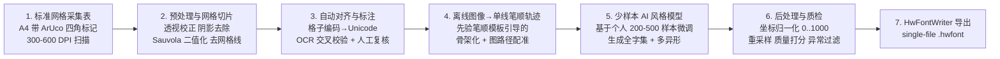

### 16.2 采集表设计（降低标注与风格迁移门槛）

- **最少采集集（约 300–500 字，3–4 张 A4 纸）**：
  - 覆盖高频汉字偏旁部首代表字（精选 260 字覆盖 GB2312 一级 98% 部件组合）+ 全部数字 `0–9`、大小写拉丁 `A–Z a–z`、常用中英文标点与数学符号（约 120 个，建议直接手写 3 遍以获得纯真实异形）。
- **纸面定位**：每张采集表四角印制 ArUco 标记 + 页码二维码，格子为淡青色（Cyan）细线——扫描后可通过色彩通道分离/HSV 阈值无损滤除格线，避免破坏黑色笔迹。

### 16.3 阶段 4：静态扫描件 → 有向有序单线轨迹（解决"无笔顺"核心痛点）

纯形态学细化（Zhang–Suen / Lee 骨架化）在笔画交叉处会产生"毛刺、断裂、伪 T 型分叉"，且完全没有书写方向与笔顺。采用 **先验笔顺引导的图像轨迹恢复（Template-Guided Trajectory Recovery）** 两阶段方案：

1. **几何骨架提取**：
   - 自适应二值化 + 连通域去噪 → 距离变换（Distance Transform）估算笔宽 `w_stroke` → 中轴细化 → 剪除长度 `< 1.2 × w_stroke` 的短毛刺 → 将骨架拆分为无交叉的骨架图 `G = (V, E)`（度 ≠ 2 的点为节点/交叉点）。
2. **标准笔顺先验配准与解耦**：
   - 引入开源标准笔顺矢量库（如 **MakeMeAHanzi** 含 9000+ 汉字标准中线轨迹与笔顺，Apache/LGPL 兼容数据需按其许可保留声明）作为该字的结构先验 `T = {s_1, s_2, ..., s_k}`。
   - 对扫描字形与标准模板做 **TPS（薄板样条）/ CPD（相干点漂移）非刚性配准**，将模板的每条有序有向笔画投影到扫描字骨架图上；
   - 在骨架图上以 **方向连续性 + 与配准模板距离最小** 为代价搜索匹配路径，在交叉点处按切线夹角最小化贯通笔画（避免拐错分支），最终恢复出属于**该书写者真实几何形态**且**具备正确笔顺与书写方向**的单线轨迹；
   - 对无法配准的连笔/草写异常字，回退至**在线轨迹恢复神经网络（Offline-to-Online / Stroke-Order Transformer）**预测序列，并标记 `quality < 0.7` 进入人工抽检队列。

### 16.4 阶段 5：少样本 AI 笔迹轨迹生成（同字异形 + 补全全字库）

- **模型选型（序列坐标生成，而非像素图像生成）**：
  - 核心路线：**内容-风格解耦的在线中文笔迹轨迹生成模型**（代表架构：**SDT — Style-Disentangled Transformer** / **FontRNN + Style Encoder** / **Diffusion-based Online Trajectory Generator**，均在开源 CASIA-OLHWDB 1.0–1.2 在线中文手写数据集上预训练）。
  - **输入**：
    - 内容条件：目标字的标准单线中线序列或部件骨架图；
    - 风格条件：当前书写者经阶段 4 恢复出的 15–30 张真实笔迹样本（Encoder 提取全局风格向量 + 局部字形风格 Token）；
    - 随机潜变量 `z`（用于同一字符采样多个风格一致但形态自然的异形）。
  - **少样本微调（LoRA / DreamBooth-style Fine-tuning）**：在 Colab T4/L4 上以该书写者 300–500 条已恢复真实轨迹微调 15–30 分钟（约 50–100 epoch），即可保留书写者个人起收笔习惯、转折顿挫、字宽倾角与结构松紧。
  - **输出格式**：每个点为 `(Δx, Δy, pen_state)`（`pen_state ∈ {down, lift, end}`），直接对应单线矢量笔画，天然无像素转矢量失真。
- **批量生成与同字异形策略**：
  - 对 GB2312 一级字表（3,755 字）+ 补充常用字（共约 4,200 字）：
    - 真实扫描已有的字：原始恢复轨迹作为 `variant_no=0`（`source="scan", weight=1.5`），AI 生成补充 3 个异形（`source="generated", weight=1.0`）；
    - 未扫描的字：以不同潜变量 `z` + 温度采样生成 4 个异形，过滤相似度过高（Chamfer 距离过小）或结构崩坏的候选。
  - 数字、英文字母、常用标点与数学符号：**强烈建议全部由书写者手写 3–5 遍直接入库**（`source="scan"`），成本极低（不到 1 页 A4）且能保证公式与正文视觉完全统一。

### 16.5 阶段 6–7：自动化质检门禁与导出

每条候选异形必须通过质检门禁方可写入 `.hwfont`：

| 检查项 | 门禁规则 |
|---|---|
| 合法坐标 | 归一化到 `[60, 940]` 居中（保留书写者原始高宽比与重心偏移），全部点落在 `[0, 1000]` |
| 笔画数合理性 | 与标准字笔画数偏差不超过 `[-35%, +20%]`（允许合理连笔，拒绝严重缺笔或噪点碎片） |
| 可读性回检（OCR 闭环） | 将生成单线轨迹以固定笔宽渲染为 128×128 灰度图，用轻量中文手写识别器回检 Top-3 命中目标字，未命中则降权或重采 |
| 异形多样性 | 同一字符任意两异形归一化 Chamfer 距离需 ≥ 18u，防止"假异形" |
| 机械臂友好性 | 去除自相交死结、单笔点数限制 ≤ 120（RDP 简化容差 4u）、总点数 ≤ 450 |

通过门禁后由 `HwFontWriter` 批量写入并执行 `finalize()`（计算 `content_sha256`、`VACUUM`、`journal_mode=DELETE`），导出 `<writer_name>_v1.0.hwfont`（约 6–12 MB）。

---

## 17. 前端集成要点

> 视觉规范、交互细节与原型见 `docs/ui_design.md` 与 `docs/ui_prototype.html`。本节仅约定前后端工程集成规范。

1. **类型强同步**：后端提供 `scripts/export_openapi.py` 导出 `openapi.json`，前端通过 `openapi-typescript` 生成 `src/api/schema.d.ts`；CI 校验无未提交的 schema 漂移。
2. **零拷贝画布数据流**：预览画布请求 `/api/v1/layouts/{id}/pages/{p}/paths?format=f32`，以 `ArrayBuffer → Float32Array` 直接送入 Canvas 2D（或 Web Worker + `OffscreenCanvas`）绘制，避免 100k+ 线段反序列化 JSON 引起的 GC 卡顿。
3. **WS 断线重连与状态同步**：
   - 前端维护 `lastSeq`，断线采用指数退避（0.5s → 1s → 2s → 5s）重连；
   - 重连成功后立即拉取一次 `GET /writers/active`、`GET /machine/profiles` 与当前活跃 `GET /jobs/{id}` 刷新全量快照，防止丢失断线期间的 `job.event`（如 `paper_change_required`）。
4. **高频输入防抖**：排版参数滑块（扰动、字号、行距、剖面线间距）在前端防抖 250 ms 后再触发 `POST /layouts`，并携带 `AbortController` 取消尚未返回的旧请求；键盘点动按键走 WS `jog` / `jog.cancel` 以获得最低延迟。
5. **安全操作二次保障**：E-Stop 按钮同时向 WS `estop` 与 `POST /api/v1/machine/estop` 双发（后端幂等去重），确保任一通道拥塞时仍可在 < 30 ms 触发软复位。

---

## 18. 目录脚手架

```text
handwrite/
├── pyproject.toml                       # workspace 根配置（uv workspace）
├── README.md
├── config/
│   ├── default_profiles.json            # 预置机器配置（CoreXY 舵机 / Z 轴步进）
│   └── mineru.env.example               # MinerU 离线与 12GB 显存配置模板
├── docs/
│   ├── framework_architecture.md        # 本文档
│   ├── ui_design.md                     # UI/UX 设计规范
│   └── ui_prototype.html                # 可交互静态视觉原型
├── packages/
│   └── hwfont_sdk/                      # Host 与 Colab Builder 共享的 .hwfont 编解码库
│       ├── pyproject.toml
│       └── hwfont_sdk/
│           ├── __init__.py
│           ├── schema.py                # SQLite DDL、HwFontMeta Pydantic 模型
│           ├── codec.py                 # HWS1 笔画二进制编解码（varint + zigzag）
│           ├── reader.py                # HwFontReader（ro + immutable + LRU）
│           ├── writer.py                # HwFontWriter（构建、校验、VACUUM）
│           └── verify.py                # content_sha256 与几何完整性校验
├── backend/
│   ├── pyproject.toml
│   └── handwrite/
│       ├── __init__.py
│       ├── __main__.py                  # `python -m handwrite` 启动入口
│       ├── config.py                    # 路径、端口、MinerU 配置
│       ├── api/
│       │   ├── app.py                   # FastAPI 组装、CORS、静态托管前端 dist
│       │   ├── schemas.py               # Contract v1 全部 Pydantic 请求/响应模型
│       │   ├── ws.py                    # /ws/telemetry 广播与 C->S 指令路由
│       │   └── routes/
│       │       ├── health.py
│       │       ├── writers.py
│       │       ├── documents.py
│       │       ├── layouts.py
│       │       ├── machine.py
│       │       ├── jobs.py
│       │       └── tasks.py
│       ├── core/
│       │   ├── events.py                # 进程内异步 EventBus
│       │   ├── db.py                    # app.db SQLite 连接与迁移
│       │   └── tasks.py                 # 后台任务与进程池调度
│       ├── writers/
│       │   ├── registry.py              # WriterRegistry + watchdog 热插拔
│       │   ├── selector.py              # VariantSelector + 回退链
│       │   └── fallback/                # 内置 Hershey 单线回退字库
│       ├── docparse/
│       │   ├── docir.py                 # DocIR 数据模型
│       │   ├── docx_parser.py           # pandoc + python-docx（OMML/图表 XML）
│       │   ├── pdf_parser.py            # PyMuPDF + MinerU 适配
│       │   ├── mineru_worker.py         # 独立子进程封装、分块、OOM 降级
│       │   └── chart_extract.py         # PDF 矢量图表提取 + 栅格图表向量化
│       ├── layout/
│       │   ├── composer.py              # 主入口（reflow / overlay 双模式）
│       │   ├── shaper.py                # 字符度量、禁则、断行、分页
│       │   ├── perturb.py               # 确定性分层随机源与拟人扰动
│       │   ├── math_typesetter.py       # LaTeX 子集词法/语法/单线盒模型
│       │   ├── math_geom.py             # 分数线、根号、定界符、积分号单线几何
│       │   ├── table_renderer.py        # 表格手绘线与单元格排布
│       │   ├── chart_renderer.py        # 图表绘制 + 剖面线 Hatching + 手绘化
│       │   └── export.py                # JSON & Float32 路径导出
│       ├── gcode/
│       │   ├── optimizer.py             # RDP 简化、边界校验、分组 greedy+2opt
│       │   └── compiler.py              # G-code 生成、行号↔笔画映射、耗时估算
│       └── grbl/
│           ├── controller.py            # MachineController 状态机与安全序列
│           ├── streamer.py              # 128B 字符计数流控协议
│           ├── transport.py             # SerialIOThread 专用串口线程
│           ├── parser.py                # GRBL `<...>` 状态行与错误码解析
│           └── mock.py                  # MockGrbl 物理运动与故障注入仿真器
├── frontend/                            # React + Vite + TypeScript + Zustand
│   ├── package.json
│   └── src/
│       ├── api/                         # OpenAPI 生成类型 + REST/WS 客户端
│       ├── store/                       # Zustand stores（machine/job/layout/writer）
│       ├── canvas/                      # 分页多图层 Canvas 2D 渲染引擎
│       └── components/                  # 工作台面板组件
├── colab_builder/
│   ├── pyproject.toml
│   ├── notebooks/
│   │   ├── 01_generate_sheets.ipynb     # 生成带 ArUco 标记的采集模板 PDF
│   │   ├── 02_scan_to_trajectories.ipynb# 扫描切片、标注、模板引导轨迹恢复
│   │   └── 03_train_and_export.ipynb    # 少样本微调、批量生成、质检与导出 .hwfont
│   └── hwbuilder/
│       ├── sheet_gen.py                 # 采集模板生成
│       ├── segment.py                   # ArUco 矫正、去网格、切字
│       ├── skeleton_align.py            # 骨架化 + 标准笔顺先验非刚性配准
│       ├── model_sdt.py                 # 少样本风格轨迹模型训练与推理封装
│       └── qc_export.py                 # OCR 回检、多样性校验、调用 HwFontWriter
├── scripts/
│   ├── export_openapi.py                # 导出 OpenAPI JSON 供前端生成类型
│   └── bench_mineru_vram.py             # 显存峰值采样压测脚本
└── tests/
    ├── unit/                            # hwfont_sdk / math / hatch / perturb / optimizer
    ├── golden/                          # 确定性排版快照对比（SVG/JSON）
    └── integration/                     # MockGrbl 全流程（含急停/换笔/换纸/断电续写）
```

---

## 19. 测试、质量与非功能指标

### 19.1 测试金字塔

| 层级 | 覆盖重点 | 工具 / 方法 |
|---|---|---|
| 单元测试 | `HWS1` 编解码无损往返、`.hwfont` 校验、中文禁则、LaTeX 盒模型 AST 与度量、剖面线多边形（含孔/凹形）、RDP 简化、GRBL 状态行解析 | `pytest` + `hypothesis`（属性测试） |
| 确定性回归（Golden） | 固定 `.hwfont` + `DocIR` + `seed=42` 生成的 `paths` 与 `gcode` 逐版本比对；另渲染调试 SVG 供人工目检公式与图表 | `pytest` golden fixtures |
| 硬件协议集成测试 | 使用 `MockGrbl` 跑通完整多页任务：Frame Check → 启动 → 写到第 50 笔暂停 → 换笔 → 续写 → 第 1 页换纸 → 第 2 页中途 E-Stop → 解锁 → 断点续写；同时验证 RX 字节数永不越界、E-Stop 延迟 < 30 ms | `pytest-asyncio` + `MockGrbl` |
| GPU / 显存压测 | 50 页含公式/表格/图表混排学术 PDF 连续解析，记录 `nvidia-smi` 峰值显存与 OOM 自动降级恢复 | `scripts/bench_mineru_vram.py` |
| 实机验收（HIL） | 真实 GRBL 舵机/Z 轴机械臂空跑与落笔实测：急停抬笔可靠性、换笔后二次落笔误差 ≤ 0.2 mm、套打 4 角偏差 ≤ 0.5 mm | 实机验收清单 |

### 19.2 关键非功能指标（SLO）

| 指标 | 目标值 |
|---|---|
| E-Stop 指令到达串口延迟 | P99 < 30 ms |
| 10 页 A4 纯文本重排耗时 | ≤ 3 s（含路径优化与 G-code 编译） |
| 50 页混排 PDF（RTX 4070 Super）峰值显存 | ≤ 8.5 GB（保留 ≥ 3.5 GB 余量） |
| 前端画布 100k 线段缩放/平移帧率 | ≥ 60 fps |
| 连续 10 页写字流式串口丢包/缓冲溢出率 | 0 |
| 同 seed 跨次重排一致性 | 100% 字节级一致 |

---

## 20. 风险登记与对策

| 编号 | 风险 | 影响 | 对策 |
|---|---|---|---|
| R1 | **GRBL 舵机分支差异**：不同写字机固件（标准 GRBL 1.1f vs 舵机改版）对 `M3 Sxxx` 角度范围、是否启用激光模式 `$32` 行为不同 | 抬落笔延迟不准或运动中未等舵机到位就开始移动 | `MachineProfile` 允许自定义 `servo_up`/`servo_down`/`dwell_ms`；连接时自动检查 `$32=0`（禁止激光模式，防止 `G0` 下意外更改 PWM）；强烈约定 `M5=抬笔` |
| R2 | **MinerU 版本与依赖冲突**：MinerU 更新频繁且绑定特定 `torch`/`cuda` 版本 | 主程序升级困难或显存策略失效 | 将 MinerU 隔离在独立虚拟环境与子进程；通过 `MinerUAdapter` 屏蔽 `middle.json` 字段变动，并固定本地已验证版本号 |
| R3 | **RTX 4070 Super 复杂页 OOM**：超高分辨率扫描页或巨型表格导致单批显存尖峰 | 解析进程崩溃 | 限制输入渲染 DPI（≤ 200）、每 10 页分块、设置 `MINERU_VIRTUAL_VRAM_SIZE=8`，并内置自动"块拆半 → CPU 降级"两级重试 |
| R4 | **扫描件连笔/草写导致笔顺恢复错误** | 生成字形在写字机上出现怪异回笔或断笔 | 模板配准失败自动标记低 `quality` 进入 Colab 质检面板；采集表引导书写者写清晰行楷；提供少量单字手绘修补工具 |
| R5 | **单色笔无法表达多色图表** | 柱状图/折线图多系列混淆 | 强制采用差异化剖面线角度/交叉网格 + 折线端点标记 + 同步图例重绘 |
| R6 | **内置回退字库与训练数据版权/授权** | 合规风险 | 拉丁/数学符号使用公有领域 Hershey 字体；笔顺先验遵循 MakeMeAHanzi 等开源协议并附带声明；每位书写者的 `.hwfont` 在 `meta.license` 记录本人授权声明 |
| R7 | **套打物理纸张放置偏差** | 手写文字偏离打印表格格线 | UI 提供半透明原页底图 + 全局 `offset/scale/rotation` 微调 + 块级 `nudge_mm` + 实机 Frame Check 外框试跑闭环校准 |

---

## 21. 分阶段实施路线图

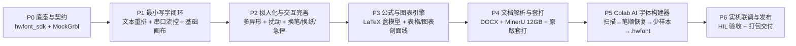

| 阶段 | 核心交付物 | 验收标准（Exit Criteria） |
|---|---|---|
| **P0：底座与契约** | `hwfont_sdk`（DDL + `HWS1` 编解码 + 内置 Hershey/测试字库）、Contract v1 Pydantic + OpenAPI 导出、`MockGrbl`、`app.db` | 单元测试全绿；前后端类型自动生成跑通；MockGrbl 通过字符计数压测 |
| **P1：最小写字闭环** | `WriterRegistry`、纯文本重排（含禁则/分页）、`PathOptimizer`、`GcodeCompiler`、`MachineController`（连接/点动/置零/外框/写字）、前端画布 `f32` 渲染 | 用测试字库输入一段中英文文本，在 MockGrbl 与实机上成功完成单页绘制与 Frame Check |
| **P2：拟人化与硬件安全** | 同字异形调度、完整拟人扰动模型、实时暂停→换笔→原位续写、多页换纸弹窗、带抬笔 E-Stop、断点续写 | 连续 3 页测试中任意位置暂停换笔、急停解锁、断电续写均零失步、零拖墨 |
| **P3：公式与图表引擎** | `MathTypesetter`（LaTeX 子集单线盒模型）、`TableRenderer`、`ChartRenderer`（柱/折/饼/散点 + 三种剖面线 + 手绘化） | Golden 测试覆盖 30+ 典型数学公式（分式/根号/积分/矩阵/分段函数）与 4 类图表，肉眼可读且与正文笔迹风格统一 |
| **P4：文档解析与原版套打** | `DocxStructuredParser`（pandoc + Chart XML）、`PdfMinerUParser`（独立子进程 + 12GB 显存管控）、`overlay` 原版坐标套打与底图对位 | 50 页混排学术 PDF 在 RTX 4070 Super 上峰值显存 ≤ 8.5 GB；A4 套打表格实机四角偏差 ≤ 0.5 mm |
| **P5：Colab AI 字体构建器** | 采集表生成器、扫描分割与去网格、模板引导笔顺轨迹恢复、少样本风格模型微调与质检导出 Notebook | 仅凭 1 位书写者的 4 页纸面扫描件，在 Colab 端到端产出 4000+ 字 × 4 异形 `.hwfont` 文件，拖入本地 UI 即时生效 |
| **P6：实机验收与打包** | 2+ 位不同书写者实机端到端验收（热插拔切换、混排作业/报告多页写完）、`uv`/安装包与一键启动脚本、操作手册 | 达成 §19.2 全部非功能指标，可交付日常使用 |
