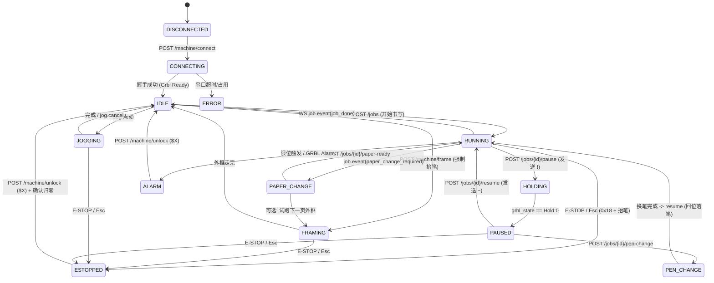

# 墨迹工坊 InkCraft —— UI/UX 设计规范

> **文档状态：设计蓝图（历史文档）**。本文写于开发初期，部分界面与字段已随实现调整（如机台档案新增的笔控、坐标与固件参数项）。
> 当前实现以前端代码与 [`openapi.json`](./openapi.json) 为准；术语见 [`README.md`](./README.md#术语表)。

> **文档版本**：v1.0（与后端系统架构契约 Contract v1 严格对齐）  
> **目标形态**：本地桌面级浏览器可视化上位机工作台（FastAPI `http://127.0.0.1:8765` + WebSocket `/ws/telemetry` + 高性能多层 Canvas 2D 矢量工作台）  
> **配套交互原型**：[`docs/ui_prototype.html`](./ui_prototype.html)

---

## 1. 设计哲学与视觉方向（Precision Plotter Atelier）

### 1.1 核心美学隐喻：精密绘图台 × 纸墨工坊
本系统不是通用的文档 SaaS 或聊天界面，而是一套**直接驱动物理写字机在真实纸张上落笔书写的精密数控工坊（Precision Plotter Workbench）**。其视觉语言融合三条工业设计脉络：

1. **博朗（Braun）/ 瑞士精密仪器控制面板**：高信噪比、克制的金属阳极氧化石墨灰表面、清晰的 1px 结构分隔线、物理仪表级等宽数字读数（DRO, Digital Readout）与触感明确的步进微调控件。
2. **建筑绘图桌与物理切割垫（Drafting Table & Cutting Mat）**：工作台中央是与真实物理写字台 1:1 映射的“纸张床”——暗色刻度切割垫衬托着暖白棉浆纸（A4/B5/A5/Letter），四周配实时联动缩放的毫米级钢尺标尺，让用户在点击“开始书写”前即可在视觉上建立**物理幅面—纸张边缘—笔尖位置**的精确直觉。
3. **工业安全人因工程（Industrial Safety Ergonomics）**：所有机械运动与危险控制严格遵循功能色彩隔离原则——常规排版参数用低饱和度中性色表达，唯独硬件状态、空移轨迹、激光外框与急停（E-STOP）拥有高饱和语义色，确保用户余光一扫即可确认“笔尖是否已抬起”、“当前是真机还是 Mock 仿真”、“写字机是否处于运动态”。

### 1.2 为什么采用“暗色机台 + 暖白纸面”双亮度对比架构
- **外围机台暗色化（Dark Precision Graphite）**：单次多页书写与微调可能持续 1~3 小时，低反射石墨灰侧栏（`#181C22` / `#1E232B`）大幅降低眼部疲劳，同时让 LED 状态灯、串口缓冲水位条和急停护罩具有极强视觉对比度。
- **中央画布真实纸色化（Warm Archival Paper `#FAF7F0`）**：用户需要评估蓝黑/碳素墨水在真实纸张上的密度、行距、手写扰动自然度及 PDF 套打对位精度。若将纸面反相为纯黑，会严重扭曲笔迹粗细与疏密感知。因此画布纸张**永远保持真实物理纸色与真实墨水色**，成为整个界面唯一的视觉焦点。

### 1.3 五项核心交互原则
| 原则 | 具体落地规则 |
| :--- | :--- |
| **物理同构（Physical Parity）** | 画布坐标系与 GRBL 机械坐标系严格一致：左上角原点 `(0, 0)`、`X` 向右、`Y` 向下，单位统一为 `mm`（保留 2 位小数）；笔尖光标在纸面上实时同步写字机真实位置。 |
| **安全默认与零阻力急停** | 一切试跑（Frame Check）、换笔、换纸与异常复位**默认先抬笔**；急停按钮（E-STOP）在顶部工具栏右上角永久常驻，快捷键 `Esc` 全局最高优先级，点击无二次确认弹窗，瞬间下发 `0x18` 软复位并强制抬笔。 |
| **仿真与真机强隔离** | 开启 `Mock GRBL` 仿真模式时，顶栏与硬件面板顶部显现醒目的琥珀色斜纹仿真徽标（`MOCK 仿真`），杜绝用户误以为真机已连接或误触发真实串口。 |
| **数值零抖动（Zero-Jitter DRO）** | 所有高频刷新的遥测数值（10Hz `mpos/wpos`、进给率、进度百分比、预计剩余时间、坐标标尺）强制启用 `font-variant-numeric: tabular-nums` 等宽数字，杜绝数字横向跳动。 |
| **排版无破坏可复现** | 所有手写随机扰动（字号抖动、斜度、基线波浪、同字异形选择）严格由无符号整数 `seed` 驱动，且套打单块开关与偏移（`overlay.blocks`）全部收敛在 `LayoutConfig` 中，保证每次重排与续写 100% 可复现。 |

---

## 2. 设计令牌系统（Design Tokens）

### 2.1 色彩系统（CSS Variables）

#### 默认主题：Precision Dark Graphite（精密石墨工坊）
```css
:root[data-theme="precision-dark"] {
  /* 机台表面层次（从底层切割垫到浮层弹窗） */
  --bg-stage:         #111418;   /* 中央绘图床/切割垫底色 */
  --bg-stage-grid:    #1A1F26;   /* 切割垫 10mm 辅网格 */
  --bg-shell:         #161A20;   /* 顶栏与底栏主背景 */
  --bg-panel:         #1B2028;   /* 左右侧功能面板背景 */
  --bg-card:          #222832;   /* 卡片、输入组与控件底色 */
  --bg-card-hover:    #2A313E;   /* 控件悬停态 */
  --bg-elevated:      #262D38;   /* 模态框、下拉菜单浮层 */

  /* 边框与分割线 */
  --border-subtle:    #262D37;   /* 面板内细分隔 */
  --border-default:   #323B48;   /* 面板与按钮常规边框 */
  --border-strong:    #455163;   /* 聚焦前高对比边框 */
  --border-focus:     #3B82F6;   /* 键盘聚焦与激活态 */

  /* 文本层次 */
  --text-primary:     #EDF1F7;   /* 标题、主数值与关键标签 */
  --text-secondary:   #9AA6B8;   /* 参数名称、辅助说明 */
  --text-muted:       #667386;   /* 单位、占位符、弱提示 */
  --text-inverse:     #0E1116;   /* 亮色徽章上的深字 */

  /* 物理纸张与画布语义色（保持恒定物理真实感） */
  --paper-surface:    #FAF7F0;   /* 暖白道林纸/棉纸 */
  --paper-margin:     rgba(59, 130, 246, 0.22); /* 页边距参考虚线 */
  --paper-rule:       rgba(148, 163, 184, 0.38);/* 信纸横线/方格 */
  --paper-shadow:     0 18px 48px rgba(0, 0, 0, 0.55), 0 2px 8px rgba(0, 0, 0, 0.35);

  /* 墨迹与轨迹渲染色 */
  --ink-indigo:       #1B365D;   /* 默认：蓝黑钢笔墨水 */
  --ink-carbon:       #181B20;   /* 可选：碳素黑中性笔 */
  --ink-royal:        #1D4ED8;   /* 可选：纯蓝圆珠笔 */
  --ink-crimson:      #B91C1C;   /* 可选：朱红批注墨水 */
  --stroke-pending:   rgba(71, 85, 105, 0.34);  /* 书写中：尚未落笔的预览路径 */
  --stroke-active:    #2563EB;   /* 当前正在书写的活跃笔画高亮 */
  --stroke-travel:    rgba(245, 158, 11, 0.62); /* G0 抬笔空移虚线（琥珀） */
  --stroke-frame:     #06B6D4;   /* Frame Check 激光外框（青色） */
  --stroke-fallback:  #E11D48;   /* 缺字回退告警描边（玫瑰红） */
  --overlay-selected: #0EA5E9;   /* 套打模式选中文字块边框 */

  /* 工业硬件与安全语义色（严禁用于纯装饰） */
  --accent-primary:   #3B82F6;   /* 主行动点 / 运行中（精密钴蓝） */
  --accent-hover:     #2563EB;
  --state-ready:      #22C55E;   /* IDLE / 已连接就绪（信号绿） */
  --state-running:    #3B82F6;   /* RUNNING / STREAMING / FRAMING */
  --state-warn:       #F59E0B;   /* PAUSED / PEN_CHANGE / PAPER_CHANGE / MOCK */
  --state-danger:     #EF4444;   /* ALARM / ESTOPPED / ERROR */
  --estop-bg:         #DC2626;   /* 急停按钮本体 */
  --estop-bg-hover:   #B91C1C;
  --estop-ring:       rgba(239, 68, 68, 0.35);
}
```

#### 备选主题：Daylight Studio（日间明亮绘图台）
面向阳光充足的桌面对位场景，通过 `data-theme="daylight-studio"` 一键切换：
- `--bg-stage: #D7DCE3`、`--bg-shell: #ECEFF3`、`--bg-panel: #F4F6F9`、`--bg-card: #FFFFFF`
- `--border-subtle: #DCE1E8`、`--border-default: #C6CFDC`
- `--text-primary: #141923`、`--text-secondary: #4E5B6E`、`--text-muted: #7C889B`
- 纸张色保持 `#FFFFFF`（配明显投影与冷灰切割垫形成对比），所有安全语义色与墨迹色维持不变。

### 2.2 字体排版与数值规范
```css
--font-sans: "Inter", "Noto Sans SC", "PingFang SC", "Microsoft YaHei", system-ui, sans-serif;
--font-mono: "JetBrains Mono", "IBM Plex Mono", "SFMono-Regular", Menlo, Consolas, monospace;
```
| 层级 | 字号 / 行高 | 字重 | 用途 |
| :--- | :--- | :--- | :--- |
| `Title / Brand` | `14px / 20px` | `600` | 顶栏应用名、模态框主标题 |
| `Section Header` | `11px / 16px` | `600` | 面板分组小标题（字距 `0.06em`，大写或中文精简短语） |
| `Body / Control` | `12.5px / 18px` | `500` | 表单标签、按钮、列表项、状态徽标 |
| `Caption / Hint` | `11px / 15px` | `400` | 单位标注、快捷键提示、缺字说明 |
| `DRO Large` | `18px / 22px` | `600` | 硬件坐标读数 `WPos X / Y`（强制 `--font-mono` + `tabular-nums`） |
| `DRO Compact` | `12px / 16px` | `500` | `MPos`、进给率、行程统计、时间轴刻度、串口日志（`--font-mono` + `tabular-nums`） |

### 2.3 空间尺度与圆角
- **基础栅格**：`4px` 增量（`4 / 8 / 12 / 16 / 20 / 24px`）。
- **圆角克制原则**：控件圆角 `6px`、面板内卡片 `8px`、模态框 `10px`、状态指示灯 `9999px`、纸张本体 `1px`（模拟真实裁切纸张的锐利边角）。

### 2.4 状态语义映射矩阵（与后端 `MachineState` & `JobState` 100% 同步）

#### 机台状态 `MachineState`（驱动顶栏状态徽章与硬件面板操作锁）
| `machine_state` | 中文显示 | 指示灯色 & 动效 | 允许的硬件操作 | 禁止的操作（置灰 + Tooltip 原因） |
| :--- | :--- | :--- | :--- | :--- |
| `DISCONNECTED` | 未连接 | 灰 `#64748B` 静止 | 连接串口、开启 Mock、离线排版与模拟回放 | Jog、归零、抬落笔、外框试跑、开始书写 |
| `CONNECTING` | 连接握手 | 钴蓝脉冲 | 取消连接 | 所有运动与任务指令 |
| `IDLE` | 就绪待命 | 信号绿常亮 | 全部操作（Jog、归零、抬落笔、外框试跑、开始书写） | 暂停、续写、换笔、解锁 |
| `JOGGING` | 手动点动 | 钴蓝呼吸 | 取消点动（`jog/cancel`）、E-STOP | 开始书写、外框试跑、断开串口 |
| `FRAMING` | 外框试跑 | 青色呼吸 | 暂停/中止、E-STOP | Jog、开始书写、归零 |
| `RUNNING` | 书写中 | 钴蓝流动条 | 暂停（`!`）、换笔（先暂停）、E-STOP | Jog、归零、切换书写人/重排（需先停止） |
| `HOLDING` | 减速保持 | 琥珀闪烁 | 等待进入 `PAUSED`、E-STOP | Jog、续写（减速完成前禁用） |
| `PAUSED` | 已暂停 | 琥珀常亮 | 续写（`~`）、换笔泊位、中止任务、E-STOP | Jog（防止丢失工作坐标）、归零 |
| `PEN_CHANGE` | 换笔模式 | 琥珀脉冲 | 抬落笔测试、续写回位（`~`）、中止、E-STOP | 手动 XY Jog、切换文档 |
| `PAPER_CHANGE` | 等待换纸 | 琥珀脉冲 | 抬笔避让、下一页外框试跑、确认已换纸（`paper-ready`）、中止 | 直接续写（必须显式确认换纸） |
| `ALARM` | 机台告警 | 红色高频闪烁 | `$X` 解锁、查看告警码、E-STOP、断开 | 所有运动与作业指令 |
| `ESTOPPED` | 紧急停止 | 警戒红常亮 + 顶栏警示条 | `$X` 解锁复位、重新归零、中止旧任务 | 一切运动指令与直接续写 |
| `ERROR` | 通信错误 | 红色常亮 | 重连串口、切换 Mock、查看串口日志 | 一切运动指令 |

#### 作业状态 `JobState`（驱动底部进度条与作业横幅）
`QUEUED`（排队中）→ `PREPARING`（生成 G-Code）→ `STREAMING`（流式下发中）⇄ `PAUSED`（已暂停）/ `PEN_CHANGE`（换笔中）/ `WAIT_PAPER`（待换纸）→ 终态 `COMPLETED`（全部完成）/ `ABORTED`（人工中止）/ `FAILED`（异常失败）。

---

## 3. 空间架构与多面板工作台布局

### 3.1 桌面端五区拓扑结构（1440 × 900 标准基准）
```text
+---------------------------------------------------------------------------------------------------+
| [LOGO 墨迹工坊]  [文档: 力学实验报告.pdf (2页)]  [模式: 智能重排 | 原版套打]   [● IDLE · MOCK] [■ E-STOP] |  48px Top Command Bar
+----------------------+----------------------------------------------------+-----------------------+
|  LEFT STUDIO (304px) |            CENTER VECTOR STAGE (1fr)               |  RIGHT CONSOLE (320px)|
|                      | +------------------------------------------------+ |                       |
| [Tab: 笔迹 | 排版 |  | | 工具浮条: [缩放 85%] [适应] [空移 T] [外框 B]  | | [连接与机台配置]       |
|       扰动]          | |          [墨色●] [套打底图] | [第 1/2 页 <>]   | |  COM3 · 115200 [断开] |
|                      | +--+---------------------------------------------+ |  Profile: 舵机A4 [⚙]  |
| 1. 书写人热切换       | 标 |   0   20   40   60   80  100  120  140  160   | |  [✓] Mock GRBL 仿真 |
|  [林清浅·行楷  ✓]    | 尺 +---------------------------------------------+ |                       |
|  [陈工·工程体   ]    | 20 |  +---------------------------------------+  | | [实时坐标 DRO]         |
|  [周教授·草意   ]    | 40 |  |   实验报告：单线手写与力学分析          |  | |  WPos X 042.50 Y 088.2|
|  [+导入] [字形检测]  | 60 |  |   F(x) = ∫ (αx²+β)/√(1+k²) dx         |  | |  MPos X 042.50 Y 088.2|
|                      | 80 |  |   [手绘斜线填充柱状图 + 表格]           |  | |  笔态: ↑抬起  缓冲84%|
| 2. 缺字回退告警(2)   |100 |  |   ┄┄ 琥珀空移线   ┌─青色外框─┐         |  | |                       |
|  [“牾”×1] [“Ω”×2]    |120 |  |                  ● 实时笔尖            |  | | [Jog 手动控制盘]       |
|                      |140 |  +---------------------------------------+  | |  [↖][↑][↗] 步长:     |
| 3. 动态参数区         |    |                                             | |  [←][0][→] 0.1|1|10  |
|  (随左侧 Tab 切换：   |    |   (支持滚轮缩放 / 空格拖曳 / 点击套打块)     | |  [↙][↓][↘] [G92归零] |
|   文档与排版参数 /    |    +---------------------------------------------+ |  [↑ 抬笔] [↓ 落笔测试] |
|   自然扰动与图表参数) |                                                    | |                       |
|                      |                                                    | | [作业执行区]           |
|                      |                                                    | |  [⛶ 外框试跑 Frame]  |
|                      |                                                    | |  [▶ 开始书写]         |
|                      |                                                    | |  [⏸ 暂停] [✎ 换笔]   |
|                      |                                                    | |  [↺ 续写] [✕ 中止]   |
+----------------------+----------------------------------------------------+-----------------------+
| [▶ 预览回放] [1×/4×/16×]  ━━●━━━━━━━━━━━━  笔画 148/412 · 绘 2.41m · 空 0.68m · 剩 01:42  [>_ 串口日志] |  52px Transport Bar
+---------------------------------------------------------------------------------------------------+
```

### 3.2 区域职责与尺寸约束
1. **Top Command Bar（高度 `48px`，固定）**
   - 左侧：品牌标识 + 当前文档选择器（快速上传 `.docx`/`.pdf` 与 MinerU 解析进度胶囊）。
   - 中央：核心模式分段切换器（**智能手写重排 Reflow** / **原版坐标套打 Overlay**），切换时平滑过渡左侧参数区与画布底图层。
   - 右侧：硬件状态复合胶囊（`MachineState` + `grbl_state` + `MOCK` 警示徽章）+ 主题切换 + **永久高亮的物理护罩式急停按钮 `E-STOP`**（宽高至少 `96px × 32px`，绝不折叠进菜单）。
2. **Left Studio Panel（宽度 `304px`，可折叠至 `48px` 图标轨）**
   - 采用 3 个高内聚子标签页，避免超长垂直滚动：
     - **笔迹（Writers）**：`.hwfont` 书写人卡片列表（热切换）、拖拽导入 `.hwfont`、覆盖率条形指标、缺字回退清单、打开字形检测器（Glyph Inspector）。
     - **排版（Layout）**：文档上传与块列表；在 Reflow 下显示纸张预设（A4/A5/B5/Letter/自定义）、边距、字号、行距、字距、对齐与信纸横格线；在 Overlay 下显示 PDF 原版底图透明度、全局 `offset_mm (x, y)`、缩放/旋转微调及**逐块启用开关与局部 `nudge_mm` 列表**。
     - **扰动（Style）**：自然手写扰动参数（字号抖动、斜度、基线正弦波幅/周期、间距抖动、旋转抖动、同字异形防重复策略与窗口、`seed` 随机种子锁定/掷骰）、公式缩放比例、图表阴影线填充样式/间距/角度/手绘抖动、表格边框开关与路径优化（`greedy_2opt`）。
3. **Center Multi-Layer Vector Stage（自适应 `1fr`）**
   - 顶部浮动半透明磨砂工具栏（仅占 36px，不遮挡纸张）：缩放控制、图层开关（空移 `T`、外框 `B`、原版底图 `U`、信纸线）、墨迹颜色预览、多页翻页器（`第 1 / N 页`）。
   - 顶部与左侧动态毫米标尺（与缩放矩阵同步，带鼠标十字准星红线投影）。
   - 核心 6 层堆叠 Canvas 纸张床。
4. **Right Hardware & Telemetry Console（宽度 `320px`，可折叠但作业运行态默认展开）**
   - 自上而下按操作链路编排：**① 串口连接与机台档案 → ② 实时坐标 DRO 与双缓冲仪表 → ③ 手动 Jog 控制盘与笔头测试 → ④ 外框试跑与书写作业控制**。
5. **Bottom Transport & Timeline Bar（高度 `52px` + 可向上展开 `200px` 串口终端抽屉）**
   - 空闲态：充当**单线书写顺序回放时间轴（Stroke Scrubber）**，用户可拖动进度条或按 1×/4×/16× 倍速预演写字机每一笔的落笔顺序与空移跳转。
   - 书写态（`RUNNING` / `PAUSED`）：自动锁定为**实时作业进度条**，显示当前页、已完成笔画数、实绘总长（`draw_mm`）、空移总长（`travel_mm`）、已用时与预计剩余时间（`eta_s`）。
   - 右下角折叠触发器 `>_ 串口日志`：展开后显示带时间戳与 `TX`/`RX` 着色的等宽实时 GRBL 通信流，支持过滤 `?` 状态轮询心跳以防刷屏、一键复制日志及发送自定义诊断指令（仅 `IDLE` 态开放）。

### 3.3 响应式断点策略
| 视口宽度 | 布局适配策略 |
| :--- | :--- |
| `≥ 1440px` | 三栏全展开（左 `304px` + 中 `1fr` + 右 `320px`），画布充裕，推荐主工作尺寸。 |
| `1200px – 1439px` | 左右侧栏收窄至 `276px` / `288px`，工具浮条图标化（Tooltip 提示文本）。 |
| `1024px – 1199px` | 左侧排版面板转为可滑出抽屉（保留 44px 侧边图标栏），确保中央画布与右侧硬件安全控制台始终可见。 |
| `< 1024px` | 展示“建议使用 ≥1024px 桌面窗口操控写字机”轻量提示条，左右面板互斥抽屉展开，顶栏 `E-STOP` 仍强制常驻。 |

### 3.4 全局快捷键映射表（Keyboard Shortcuts）
> **安全防误触原则**：当焦点位于 `<input>` / `<textarea>` 时，字母与数字快捷键自动屏蔽；**唯独 `Escape`（急停）在写字机处于运动态（`RUNNING` / `FRAMING` / `JOGGING` / `HOLDING`）时无视焦点，始终最高优先级触发急停！**

| 作用域 | 快捷键 | 功能 | 说明 |
| :--- | :--- | :--- | :--- |
| **全局安全** | `Escape` | **紧急停止 + 强制抬笔（E-STOP）** | 仅在 `RUNNING / FRAMING / JOGGING / HOLDING` 生效；静止态用于关闭弹窗或取消选中块 |
| **全局作业** | `Shift + Space` | 暂停（`!`） / 续写（`~`） | 避免单按 `Space` 与画布平移冲突 |
| **画布视口** | `Space + 拖拽` | 平移画布 | 按住空格鼠标变为抓手 |
| **画布视口** | `Ctrl/Cmd + 滚轮` 或 `+` / `-` | 以光标为中心缩放画布 | 范围 `25% ~ 500%` |
| **画布视口** | `0` / `1` | 适应窗口（Fit） / 100% 物理比例 | 快速复位视图 |
| **画布图层** | `T` | 显隐 `G0` 抬笔空移路径 | Toggle Travel |
| **画布图层** | `B` | 显隐外框边界框（Bounding Box） | Toggle BBox |
| **画布图层** | `U` | 显隐原版 PDF 套打底图 | 仅 Overlay 模式有效 |
| **画布分页** | `[` / `]` | 上一页 / 下一页 | 0-based `page_index` 切换 |
| **套打微调** | `方向键` / `Shift + 方向键` | 选中 Block 微调 `0.5mm` / `2.0mm` | 当画布选中了套打块时接管方向键 |
| **硬件 Jog** | `W A S D` 或 `方向键`（Jog 盘聚焦） | 写字机 XY 步进点动 | 支持 `1 / 2 / 3 / 4` 快速切换步长 `0.1 / 1 / 10 / 50 mm` |
| **硬件辅助** | `P`（Jog 盘聚焦） | 抬笔 / 落笔测试切换 | `POST /api/v1/machine/pen` |
| **时间轴** | `K` 或 点击播放 | 回放预览 播放 / 暂停 | 空闲态笔画顺序预演 |

---

## 4. 核心业务模块详细交互设计

### 4.1 书写人 `.hwfont` 热切换与字形检测器（Writer Studio & Glyph Inspector）
1. **热切换卡片列表（`GET /api/v1/writers`）**
   - 每张书写人卡片展示：实时渲染的 `preview_char` 单线笔迹微缩图（Canvas 40×40）、`writer_name`、`writer_alias`、`style_tags` 标签、字数/变体总数（如 `6,842 字 · 20,190 变体`）及当前激活态高亮蓝边。
   - 点击非当前卡片直接调用 `POST /api/v1/writers/active {writer_id}`，同时携带新 `writer_id` 触发 `POST /api/v1/layouts` 重新排版（前端保留旧缓存直到新路径就绪，实现无闪烁丝滑“热替换”）。
   - 卡片右上角提供 `检测字形` 图标按钮与 `删除` 二次确认菜单；列表底部为虚线拖拽区支持直接拖入 `.hwfont` 文件（`POST /api/v1/writers` multipart，监听 `task.progress` `kind="font_import"`）。
2. **字库覆盖率与缺字回退告警**
   - 当前书写人卡片下方折叠展示 5 维度覆盖率微进度条：`coverage.cjk`、`latin`、`digit`、`punct`、`symbol`。
   - 每次排版完成后，读取 `GET /api/v1/layouts/{layout_id}` 返回的当前页 `fallback_glyphs: [{char, count}]`。若非空，在左侧面板顶部和画布右下角同时浮现玫瑰红色告警条（例如 `当前页含 2 个缺字，已按内置单线字体回退`）：
     - 展开列表点击任意缺字胶囊（如 `牾 ×1`），画布自动平移缩放聚焦到该字符所在位置并闪烁高亮其包围盒。
     - 可直接切换 `fallback.policy`（`builtin_single_line` 内置单线回退 / `box` 空框占位 / `skip` 跳过）。
3. **字形检测器模态框（Glyph Inspector）**
   - 输入任意字符（或点击快捷示例字 / 当前文档缺字），调用 `GET /api/v1/writers/{writer_id}/glyphs/{char}`。
   - 弹窗内平铺展示该字的全部**同字异形变体卡片（`variants[]`）**：
     - 每个卡片使用 `1000 × 1000` 坐标系网格绘制，标出 `baseline_y = 800` 琥珀色基线、`x_height`、`cap_height`、`advance` 字宽线与 `bbox` 边界框。
     - 开启“显示笔顺”开关后，每笔起点标绿色圆点+序号（`1, 2, 3...`），笔画沿起止方向呈现由深到浅的渐变与方向箭头，帮助用户直观检验 Colab AI 生成的离线单线笔顺质量。

### 4.2 文档上传、MinerU 解析进度与双排版模式
1. **文档上传与 MinerU Pipeline 进度可视面板**
   - 支持点击或全窗口拖拽 `.docx` / `.pdf` 文件，调用 `POST /api/v1/documents` 获取 `{doc_id, task_id}`。
   - 当 `task.progress`（`kind="parse"`）推进时，在画布中央上方浮现非阻塞式解析状态卡片（不遮挡硬件安全区），可视化展示 7 个真实阶段：
     `upload`（文件校验）→ `convert`（页面光栅化）→ `mineru_layout`（版面区块识别）→ `mineru_ocr`（文字抽取）→ `mineru_formula`（公式转 LaTeX）→ `mineru_table`（表格结构化）→ `assemble`（文档树组装）。
   - 实时显示 `page / page_count`、`pct%` 进度条与当前阶段说明文案（如 `MinerU Pipeline 模式解析中 · 第 2/4 页公式识别（本地 GPU 12GB 显存安全模式）`）。解析完成后自动以默认配置调用 `POST /api/v1/layouts` 呈现首页笔迹。
2. **双排版模式对比与专属控件**
   - **模式 A：智能手写重排（`mode: "reflow"`）**
     - 忽略原文档死板排版，将提取的文本、公式、表格、图表按真实手写习惯流式重排到目标纸张。
     - 控件组：纸张预设（`A4` 210×297 / `B5` 176×250 / `A5` 148×210 / `Letter` / `custom`）与纵横方向；四向页边距 `margins_mm`（支持锁链联动）；正文基础字号 `font_size_mm`（3–14mm）、行距倍率 `line_spacing`、字距 `char_spacing`、段距 `paragraph_spacing_mm`、首行缩进字符数、对齐方式；信纸底纹 `ruled.style`（无 / 横线 / 方格）、线距 `pitch_mm` 以及关键开关 `ruled.draw`（区分“仅屏幕参考显示”与“写字机真实绘制格线”）。
   - **模式 B：原版坐标套打（`mode: "overlay"`）**
     - 面向试卷填空、实验报告模板、表格原位手写填报等高频刚需场景。
     - 画布自动加载 `GET /api/v1/documents/{doc_id}/pages/{page_index}/image` 作为底层半透明原版 PDF 底图（默认透明度 `underlay_opacity: 0.42`，滑块 `0%–100%` 可调）。
     - **全局套打配准控件**：`overlay.offset_mm.x / y`（支持 `±0.2mm` 步进微调，补偿打印机/装纸机械误差）、`overlay.scale`、`overlay.rotation_deg`（`±3.0°` 补偿纸张放歪）。
     - **区块级交互（Per-Block Control）**：左侧列出本页所有解析块（`text / formula / table / chart`），每项带勾选框控制 `overlay.blocks[block_id].enabled`（例如关闭原试卷的印刷题干，仅保留手写答题区！），并可在画布上直接点击块选中后用鼠标拖拽或键盘方向键实时微调 `nudge_mm {x, y}`。

### 4.3 自然手写扰动与多模态元素调参
所有扰动滑块自带**双向输入（拖杆 + 精密数字步进框）**与一键恢复默认值图标，滑动时采用 **150ms 防抖**调用 `POST /api/v1/layouts` 重排，并支持锁定 `seed` 或点击骰子按钮重新随机采样：
- **基础笔迹自然度（`perturb`）**：
  - `scale_jitter`（字号微抖动 `0 ~ 0.30`）
  - `slant_deg`（手写倾角 `-8° ~ +8°`）
  - `baseline_wave_amp_mm`（基线波浪振幅 `0 ~ 1.5mm`）与 `baseline_wave_period_mm`（周期 `30 ~ 200mm`）
  - `spacing_jitter`（字距呼吸感）、`rotation_jitter_deg`（单字微倾）
  - `variant_strategy`（`random_no_repeat` / `round_robin` / `lru`）+ `variant_no_repeat_window`（同字异形防连重窗口 `1 ~ 12` 字）
- **公式 / 图表 / 表格专项调参**：
  - `formula.scale`（`0.60 ~ 1.20`），保证分式与上下标在单线笔迹下清晰不糊笔。
  - `chart.hatch_style`（平行斜线 `parallel` / 交叉网纹 `cross` / 往复折线 `zigzag`）、`chart.hatch_spacing_mm`（阴影间距 `0.8 ~ 5.0mm`）、`chart.hatch_angle_deg`（倾角 `0° ~ 180°`）、`chart.hand_jitter_mm`（手绘抖动感）。
  - `table.draw_borders`（是否绘制表格线）与 `table.hand_jitter_mm`；`optimize.travel`（`greedy_2opt` 空移路径贪心优化开关，并实时对比优化前后的空移距离节省百分比）。

### 4.4 GRBL 硬件控制与机台配置
1. **串口连接与仿真切换**：端口下拉刷新（`GET /api/v1/machine/ports`）、波特率（默认 `115200`）、机台档案选择（`GET /api/v1/machine/profiles`）、`Mock GRBL` 开关。
2. **机台档案配置模态框（`PUT /api/v1/machine/profiles/{profile_id}`）**：
   - 抬落笔机构分段选择：**舵机模式 `servo`**（配置 `servo_up` 如 `M5`/`M3 S30`、`servo_down` 如 `M3 S90`、`dwell_ms` 落笔延时防拖尾）vs **步进 Z 轴模式 `z`**（配置 `z_up_mm`、`z_down_mm`、`z_feed`）。
   - 物理行程 `workspace_mm {x, y}`、坐标原点 `top_left | bottom_left`、`invert_x / invert_y`、书写进给 `feed_draw`、空移进给 `feed_travel`、点动进给 `jog_feed`。
   - 变更行程后，画布立即以红色虚线标示超出写字机物理工作区（Soft-Limit Out-of-Bounds）的危险路径！
3. **实时 DRO 与缓冲区遥测**：
   - 大字号显示工作坐标 `WPos X / Y`（主视角），次行显示机械坐标 `MPos X / Y` 与当前进给 `Feed (mm/min)`。
   - **笔头状态物理指示器**：`↑ 抬笔 UP`（中性灰/绿）vs `↓ 落笔 DOWN`（钴蓝实心圆点）。
   - **GRBL 双缓冲健康度条**：读取 `machine.status.buf.{planner, rx}`，直观展示前瞻规划队列与 128 字节串口接收缓冲占用率，帮助判断上位机流式下发是否平稳。
4. **触控 + 键盘双栖 Jog 控制盘**：
   - 3×3 方向按键（支持 8 方向与中心 `G92 设为原点`），下方提供 4 档快速步长芯片（`0.1` / `1` / `10` / `50 mm`）。
   - 底部独立按钮组：`↑ 抬笔测试`、`↓ 落笔测试`、`G92 XY归零`、`$X 解锁`（仅在 `ALARM`/`ESTOPPED` 高亮显现）。

---

## 5. 高性能多层 Canvas 2D 矢量渲染架构

单页密集文档（含中文正文 + 数学公式 + 阴影线填充柱状图 + 表格）常包含 **80,000 ~ 150,000 条微小矢量线段**。若用 SVG DOM 节点渲染会导致严重卡顿与内存飙升。因此采用**6 层分离式 HTML5 Canvas 2D + `Float32Array` 零拷贝管线**，确保缩放、平移、实时书写与时间轴拖动全场景稳定 **60fps**。

### 5.1 六层画布堆叠架构（Multi-Layer Stack）
| 层级 | 画布 / 图层 | 重绘触发条件 | 渲染内容与优化策略 |
| :--- | :--- | :--- | :--- |
| **Layer 0** | 切割垫与纸张基底 | 仅视口缩放/平移/换纸张时 | 暗色 10mm/50mm 物理切割垫网格、纸张投影、暖白纸面、页边距参考线、信纸横格线、写字机物理幅面越界警示框。 |
| **Layer 1** | 原版套打底图 | 仅切换页面或调整透明度/偏移时 | Overlay 模式下的原版 PDF 渲染 PNG（`drawImage` + `globalAlpha = underlay_opacity` + `offset/scale/rotation` 仿射变换）。 |
| **Layer 2** | **矢量路径离屏缓存**（OffscreenCanvas / 缓存 Canvas） | 仅在路径数据变更、缩放跨越阈值（如 2×）或切换墨色时 | 一次性将全页 100k+ 笔迹线段光栅化到高分屏离屏缓存；常规平移与实时光标更新时直接 `drawImage` 搬运（耗时 `< 1.2ms`）。 |
| **Layer 3** | 辅助叠加层（空移 & 外框 & 缺字） | 仅开关状态或选中项变更时 | `G0` 琥珀色虚线空移轨迹、青色 `bbox` 外框边界框与尺寸标注、玫瑰红缺字回退定位框。 |
| **Layer 4** | **动态书写与笔尖光标层（60fps RAF）** | 每帧（`requestAnimationFrame`） | ① 书写态/回放态：增量绘制已完成笔画（深墨色）覆盖在半透明待写底层之上；② 当前活跃笔画钴蓝高亮；③ 带抬落笔状态环的物理笔尖十字准星；④ Frame Check 激光巡边拖尾光点。 |
| **Layer 5** | 套打块交互与标尺层 | 鼠标悬停/点击/拖拽时 | Overlay 模式下各 `block_id` 的悬停虚线框、选中态控制手柄与偏移量标签；顶部/左侧毫米标尺与鼠标实时坐标投影线。 |

### 5.2 二进制路径解码与零拷贝内存布局
后端 `GET /api/v1/layouts/{layout_id}/pages/{page_index}/paths?format=f32` 返回紧凑的小端序 `Float32` 三元组流 `[x0, y0, flag0, x1, y1, flag1, ...]`：
- `flag === 0`：抬笔空移到达该点（`moveTo` / 记录空移线段）
- `flag === 1`：落笔绘制到达该点（`lineTo`）
- `flag === 2`：落笔绘制到达该点且为当前笔画终点（`stroke_index++`）

**性能账本**：
- 100,000 个顶点仅占 `100,000 × 3 × 4 bytes = 1.2 MB` 连续 `Float32Array`，解析时间 `< 1ms`，几乎零 GC 压力。
- 前端在加载二进制流的同时，单次遍历构建 `strokeOffsets: Uint32Array` 索引表（记录每一笔在 `Float32Array` 中的起始下标）。拖动底部回放时间轴或接收 5Hz `job.progress.seg_index` 时，**$O(1)$ 直接切片渲染**，无需任何对象遍历。

### 5.3 High-DPI 缩放、坐标变换与增量渲染策略
1. **DPI 清晰度**：所有 Canvas 物理像素尺寸乘以 `dpr = Math.min(window.devicePixelRatio || 1, 2)`，上下文执行 `ctx.setTransform(dpr, 0, 0, dpr, 0, 0)`，确保 0.35mm 中性笔单线在 4K/Retina 屏上锐利如真纸印刷。
2. **世界坐标 ↔ 屏幕坐标矩阵**：
   $$x_{\text{screen}} = x_{\text{mm}} \cdot s + t_x, \quad y_{\text{screen}} = y_{\text{mm}} \cdot s + t_y$$
   其中 $s = \text{pxPerMm} \times \text{zoom}$。线宽映射遵循真实物理笔芯直径（默认 `0.40mm`），同时施加最小屏幕像素下限 `Math.max(0.75, 0.40 * s)`，保证缩小时笔迹不断裂消失。
3. **缩放防卡顿降级（LOD）**：在用户持续滚轮缩放或高频拖拽期间，Layer 2 直接对现有离屏缓存执行 CSS/Canvas 仿射拉伸保证 60fps；停止交互 `120ms` 后在空闲帧异步重绘高清晰度矢量缓存。
4. **Live Drawing 增量绘制**：写字机真实书写时，维护 `renderedSegIndex` 指针，每帧仅将 `[renderedSegIndex, currentSegIndex]` 区间内新增的十几条线段追加绘制到“已写墨水缓存层”，避免每帧重绘十万条历史线段。

### 5.4 套打块命中测试（Overlay Hit-Testing）
- 加载 `GET /api/v1/documents/{doc_id}/blocks` 后，结合当前 `LayoutConfig.overlay` 的全局偏移与每块局部 `nudge_mm`，缓存每块的页内 AABB 包围盒 `[x0, y0, x1, y1]`（单页通常 10~80 个块）。
- `pointermove` / `pointerdown` 将屏幕坐标逆变换回 `mm`，倒序遍历 AABB（小块优先于大块），实现 `< 0.05ms` 精准命中与实时拖拽微调，松手后更新 `overlay.blocks[block_id].nudge_mm` 并触发防抖重排。

---

## 6. 关键交互流程与安全边界状态机

### 6.1 机台与作业核心安全状态流（Mermaid）


### 6.2 六大关键交互流与异常边界设计

#### 流程 1：原版坐标套打校准流（Exact Overlay Alignment）
1. 用户上传带空格的 PDF 试卷/表单，切换顶部至 **原版坐标套打**，画布浮现半透明原版底图。
2. 在纸张物理放上写字台后，用户在左侧区块列表中取消勾选印刷题干块，仅保留手写答题块。
3. 拖动“全局 X/Y 偏置”或点击特定答题块用方向键 `0.5mm` 微调，使单线笔迹精准落入原版横线/答题框内。
4. 点击 **外框试跑（Frame Check）**，肉眼确认笔尖悬空划过的四角与真实纸张印刷边框重合，随后点击 **开始书写**。

#### 流程 2：外框边界试跑（Frame Check）安全流
- **前置校验**：若当前页 `bbox` 超出 `MachineProfile.workspace_mm`，按钮呈红色警示态并拦截下发，画布以红色斜线区域标出越界部分，提示用户缩小纸张或调整边距/偏移。
- **执行态**：调用 `POST /api/v1/machine/frame {layout_id, page_index}`，后端强制先发抬笔指令并延时 `dwell_ms`，再以 `feed_travel` 沿 `bbox` 矩形四顶点巡行一圈。画布青色虚线框点亮，并随实时 `wpos` 绘制青色激光巡航光点，顶部徽章显示 `外框试跑 FRAMING`。

#### 流程 3：书写中“暂停 → 换笔 → 续写”（Pause → Pen Change → Resume）
1. 用户发现笔芯断墨或需换色，点击 **暂停**（或按 `Shift+Space`）→ 触发 `POST /api/v1/jobs/{id}/pause`（下发 GRBL 实时指令 `!`）。
2. 状态先进入短暂的 `HOLDING`（提示“正在平滑减速，请勿触碰笔架…”），待 `grbl_state` 稳定为 `Hold:0` 后转入 `PAUSED`。
3. 用户点击 **换笔模式**（`POST /api/v1/jobs/{id}/pen-change`）→ 写字机自动抬笔并记录精确断点坐标，平滑移动至预设的**前端换笔安全泊位**，前端收到 `job.event: pen_change_ready` 后弹出紧凑型换笔引导卡：
   - 步骤提示：① 取下旧笔并装入新笔；② 可点击卡内 `↓ 落笔微触测试` / `↑ 抬笔` 验证笔尖压纸力度；③ 确认无误后点击 **回位并继续书写**（`POST /api/v1/jobs/{id}/resume`）。
   - 系统自动抬笔返回精确断点、重新落笔延时后无缝接续下一条线段，**杜绝偏移与断层**。

#### 流程 4：急停与安全恢复（Emergency Stop & Recovery）
1. 任意时刻点击右上角红色 `E-STOP` 或按下 `Esc`：前端**同时**通过 WebSocket 发送 `{type:"estop"}`（最低延迟通道）并兜底调用 `POST /api/v1/machine/estop`。
2. 后端立即向串口写入 `0x18`（Soft Reset）并发送最高优先级抬笔指令，同时挂起流式任务。
3. 界面进入 `ESTOPPED` 强警示态：
   - 顶栏下方展开 36px 警戒红条：`⚠️ 已触发紧急停止（笔头已尝试抬起）— 写字机可能已丢失步进位置，禁止直接续写`。
   - 提供清晰的两步恢复引导：① 清理纸张/笔头障碍后点击 **`$X` 解除锁定**（`POST /machine/unlock`）；② 建议执行 Jog 回原点并 **`G92` 重新归零** 后重新发起作业（或显式点击“放弃本次作业”）。

#### 流程 5：多页换纸模态框（Multi-Page Paper Change Modal）
- 多页任务中每写完一页，后端抬笔回停靠位并推送 `WS job.event {event:"paper_change_required", page_index: nextPage}`，机台转入 `PAPER_CHANGE`。
- 前端弹出**不可通过点击遮罩误关闭**的换纸提示模态框（仅允许明确点击按钮操作）：
  - 左侧：刚完成页（如第 1 页）的统计摘要（耗时、绘制长度）+ 下一页（第 2 页）的矢量缩略预览图与预计耗时。
  - 右侧操作指引与三项安全动作：
    1. **移至避让位 / 确认已抬笔**：方便双手取出已写纸张并压好空白新纸。
    2. **试跑第 2 页外框（可选）**：触发一次 `POST /machine/frame`，确保新放的纸张没有放歪。
    3. **主按钮：`我已换好新纸，开始第 2 页`**（`POST /api/v1/jobs/{id}/paper-ready {page_index: 1}`）。
  - 次要破坏操作：`中止剩余页面`（带二次确认）。

#### 流程 6：边缘与异常态覆盖
- **WebSocket 断线重连**：状态栏切为琥珀/红闪烁“后端连接中断，正在第 N 次重连…”，采用指数退避（`0.5s → 1s → 2s → 5s`），重连成功后自动拉取 `/health`、`/writers/active`、`/jobs/{id}` 恢复全量现场状态。
- **单线空页 / 0 笔画拦截**：若用户在套打模式关闭了所有 Block，点击“开始书写”或“外框试跑”时给出温和 Toast 提示并禁用下发。
- **排版期间任务锁**：写字机处于 `RUNNING / PAUSED / PEN_CHANGE / PAPER_CHANGE` 时，允许切换查看页面预览，但锁定写入新排版/切换书写人（提供悬浮说明“书写进行中，修改排版参数将在当前任务结束或中止后生效”）。

---

## 7. 前端组件树与 Zustand + WebSocket 状态架构

### 7.1 React + TypeScript 目录与组件树
```text
src/
├── api/
│   ├── restClient.ts              # 强类型 REST /api/v1/* 封装（与 Contract v1 100% 一致）
│   ├── telemetrySocket.ts         # /ws/telemetry 断线重连、心跳与类型安全分发器
│   └── types.ts                   # MachineState, JobState, LayoutConfig, WriterMeta, WS 载荷定义
├── stores/
│   ├── useMachineStore.ts         # 机台连接、档案、低频状态与高频遥测 Transient 旁路通道
│   ├── useWriterStore.ts          # 书写人列表、当前激活 writer_id、字形变体缓存
│   ├── useDocumentLayoutStore.ts  # 文档解析任务、LayoutConfig、分页路径 Float32Array 缓存、缺字列表
│   └── useViewportStore.ts        # 缩放/平移矩阵、图层开关、选中套打块、回放进度、弹窗状态
├── canvas/
│   ├── VectorStageEngine.ts       # 纯 TypeScript 6 层 Canvas 2D 渲染引擎（脱离 React 生命周期）
│   ├── f32PathDecoder.ts          # Float32Array 二进制解析 + strokeOffsets 索引构建
│   ├── overlayHitTest.ts          # 套打块 AABB 命中测试与拖拽吸附计算
│   └── rulerRenderer.ts           # 动态毫米标尺绘制器
└── components/
    ├── layout/
    │   ├── TopCommandBar.tsx      # 品牌、文档状态、Reflow/Overlay 切换、状态胶囊、E-STOP
    │   ├── EstopRecoveryBanner.tsx# ESTOPPED / ALARM / MOCK 全局警戒横幅
    │   └── BottomTransportBar.tsx # 时间轴回放 / 实时作业进度 + 串口日志抽屉
    ├── studio/ (Left Panel)
    │   ├── WriterListPanel.tsx    # .hwfont 热切换卡片、导入拖拽、覆盖率、缺字告警
    │   ├── GlyphInspectorModal.tsx# 同字异形 0..1000 网格 + 笔顺可视化检测弹窗
    │   ├── DocumentLayoutPanel.tsx# 上传、MinerU 7 阶段进度、Reflow 参数、Overlay 配准与块控制
    │   └── PerturbStylePanel.tsx  # 手写扰动滑块、公式/图表填充、表格与随机种子
    ├── stage/ (Center)
    │   ├── VectorCanvasStage.tsx  # 承载 VectorStageEngine 的薄 React 容器 + 快捷键绑定
    │   └── StageFloatingBar.tsx   # 缩放、空移/外框/底图开关、墨色选择、分页器
    └── hardware/ (Right Panel)
        ├── ConnectionCard.tsx     # 串口/波特率/Profile/Mock 连接管理
        ├── MachineProfileModal.tsx# 舵机 M3/M5 vs 步进 Z 轴、幅面与速度配置弹窗
        ├── DroTelemetryCard.tsx   # WPos/MPos 等宽读数、笔头指示器、Planner/RX 双缓冲条
        ├── JogControlPad.tsx      # 8 向步进点动盘、步长芯片、G92 归零、抬落笔测试
        ├── JobActionPanel.tsx     # 外框试跑、开始/暂停/换笔/续写/中止控制组
        ├── PaperChangeModal.tsx   # 多页换纸续打安全模态框
        └── PenChangePopover.tsx   # 换笔泊位引导与落笔微触测试卡
```

### 7.2 Zustand 状态分层与高频遥测零卡顿设计
> **核心架构决策**：WebSocket 每秒推送 10 次 `machine.status`（10Hz）与 5 次 `job.progress`（5Hz）。如果直接将 `mpos / wpos / pen_xy / seg_index` 写入普通 React state，会引发整个工作台每秒 15 次 React Diff，导致滑块掉帧和 Canvas 抖动。

为此采用 **“React 低频状态 + Transient Ref 高频旁路”双通道架构**：
1. **低频离散状态进 Zustand Reactive Store**（引发必要 UI 刷新）：
   - `machineState`、`jobState`、`grblState`、`pen`、`mock`、`alarmCode`、`activeWriterId`、`layoutConfig`、`currentPageIndex`、`activeModal`（换纸/换笔/机台配置/字形检测）。
2. **高频连续坐标走 `telemetryBus` / Zustand `subscribe` 瞬态旁路**（绕过 React Render）：
   - `VectorStageEngine` 直接订阅 `telemetryBus`，在 `requestAnimationFrame` 中读取最新 `pen_xy` 与 `seg_index` 增量绘制笔尖光标和已完成墨迹，帧率锁死 60fps。
   - `DroTelemetryCard` 中的 `WPos X/Y`、`MPos X/Y`、进度条宽度与 `RX/Planner` 缓冲条通过直接更新 DOM `textContent` / `style.transform` 渲染，完全零虚拟 DOM 开销。
   - `serial.log` 写入定长环形缓冲（上限 500 条），仅在串口抽屉展开时以虚拟列表按 `100ms` 节流刷新。

### 7.3 与后端 Contract v1 对齐的核心 TypeScript 契约摘录
```ts
export type MachineState =
  | 'DISCONNECTED' | 'CONNECTING' | 'IDLE' | 'JOGGING' | 'FRAMING'
  | 'RUNNING' | 'HOLDING' | 'PAUSED' | 'PEN_CHANGE' | 'PAPER_CHANGE'
  | 'ALARM' | 'ESTOPPED' | 'ERROR';

export type JobState =
  | 'QUEUED' | 'PREPARING' | 'STREAMING' | 'PAUSED'
  | 'PEN_CHANGE' | 'WAIT_PAPER' | 'COMPLETED' | 'ABORTED' | 'FAILED';

export interface WsEnvelope<T extends string = string, D = unknown> {
  v: 1;
  type: T;
  seq: number;
  ts: number;
  data: D;
}

export interface MachineStatusData {
  machine_state: MachineState;
  job_state: JobState | null;
  grbl_state: 'Idle'|'Run'|'Hold:0'|'Hold:1'|'Jog'|'Alarm'|'Door'|'Check'|'Home'|'Sleep';
  mpos: { x: number; y: number; z: number };
  wpos: { x: number; y: number; z: number };
  feed: number;
  pen: 'up' | 'down';
  buf: { planner: number; rx: number };
  alarm_code: string | null;
  mock: boolean;
}

export interface JobProgressData {
  job_id: string;
  job_state: JobState;
  page_index: number;
  page_count: number;
  stroke_index: number;
  stroke_total: number;
  seg_index: number;
  seg_total: number;
  line_acked: number;
  line_total: number;
  pct: number;
  pen_xy: { x: number; y: number };
  elapsed_s: number;
  eta_s: number;
  draw_mm: number;
  travel_mm: number;
}

export interface LayoutConfig {
  mode: 'reflow' | 'overlay';
  page: {
    size: 'A4' | 'A5' | 'B5' | 'Letter' | 'custom';
    width_mm: number;
    height_mm: number;
    orientation: 'portrait' | 'landscape';
    margins_mm: { top: number; right: number; bottom: number; left: number };
  };
  text: {
    font_size_mm: number;
    line_spacing: number;
    char_spacing: number;
    paragraph_spacing_mm: number;
    first_line_indent_chars: number;
    align: 'left' | 'justify' | 'center';
    ruled: { style: 'none' | 'lines' | 'grid'; pitch_mm: number; draw: boolean };
  };
  perturb: {
    seed: number;
    scale_jitter: number;
    slant_deg: number;
    baseline_wave_amp_mm: number;
    baseline_wave_period_mm: number;
    spacing_jitter: number;
    rotation_jitter_deg: number;
    variant_strategy: 'random_no_repeat' | 'round_robin' | 'lru';
    variant_no_repeat_window: number;
  };
  formula: { scale: number; stroke_style: 'handwrite' };
  chart: {
    hatch_spacing_mm: number;
    hatch_angle_deg: number;
    hatch_style: 'parallel' | 'cross' | 'zigzag';
    hand_jitter_mm: number;
  };
  table: { draw_borders: boolean; hand_jitter_mm: number };
  overlay: {
    offset_mm: { x: number; y: number };
    scale: number;
    rotation_deg: number;
    underlay_opacity: number;
    blocks: Record<string, { enabled: boolean; nudge_mm: { x: number; y: number } }>;
  };
  optimize: { travel: 'greedy_2opt' | 'none'; simplify_tol_mm: number; join_tol_mm: number };
  fallback: { policy: 'builtin_single_line' | 'skip' | 'box' };
}
```

### 7.4 交互验证与设计交付清单
本规范配套提供了零依赖、浏览器直接双击即可运行的交互原型 [`docs/ui_prototype.html`](./ui_prototype.html)，真实实现了以下端到端交互验证：
- 三位风格迥异的书写人 `.hwfont` 热切换 + **字形检测器（同字异形变体 + 笔顺起止点 + `baseline_y=800` 坐标网）** + 缺字告警定位；
- 真实 HTML5 Canvas 单线中文手写正文 + 单线手写数学积分分式公式 + 参数化斜线/交叉/折线填充手绘柱状图 + 手绘实验数据表格（共 2 页完整文档）；
- **智能重排（Reflow）** 与 **原版坐标套打（Overlay）** 实时切换（含半透明 PDF 试卷底图、全局 XY 偏置、画布点击选中 Block 开关与微调）；
- 全部手写扰动与图表填充滑块 60fps 实时响应 + `G0` 琥珀色空移线与 `bbox` 青色外框一键显隐 + 滚轮缩放/空格平移/动态毫米标尺；
- 完整 GRBL Mock 硬件仿真闭环：串口/档案配置、8向 Jog 与 `G92` 归零、抬落笔测试、**外框边界试跑动画**、**实时书写→暂停→换笔→续写**、**多页换纸模态框**、**一键 E-STOP 急停与 `$X` 解锁恢复**及实时串口 G-Code 日志终端。
